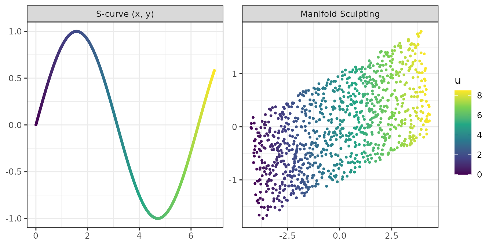
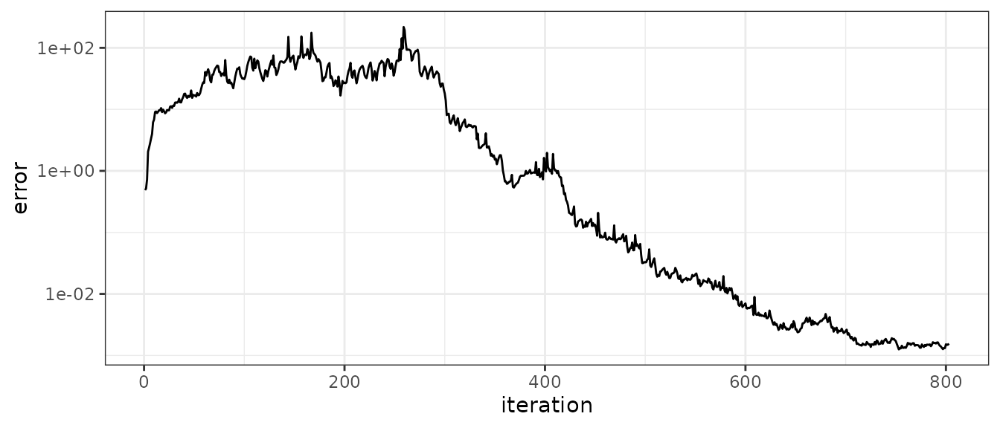

# Introduction to manifoldsculpting

Manifold Sculpting (Gashler, Ventura and Martinez, 2008) is a nonlinear
dimensionality reduction method. Like Isomap or locally linear embedding
(LLE), it assumes that the data lie on a low-dimensional manifold, and
it looks for coordinates on that manifold by preserving the
relationships between neighboring points. Unlike these methods, it does
not solve an eigenproblem: it transforms the data iteratively.

This vignette explains the algorithm, its parameters, and its use with
recipes.

``` r

library(manifoldsculpting)
library(recipes)
```

## The algorithm

1.  **Neighbors.** The `k` nearest neighbors of each point are found.
2.  **Relationships.** For each point \\p_i\\ and neighbor \\n\_{ij}\\,
    the distance \\\delta\_{ij}\\ between them is recorded, together
    with the angle \\\theta\_{ij}\\ formed by \\p_i\\, \\n\_{ij}\\ and
    \\m\_{ij}\\, the neighbor of \\n\_{ij}\\ that is the most colinear
    with \\p_i\\ (the angle closest to \\\pi\\). \\\delta\_{ave}\\ is
    the average neighbor distance.
3.  **Rotation.** The data are rotated onto their principal components.
    The first `ndim` components are the *preserved* dimensions, the
    others are the *scaled* dimensions.
4.  **Sculpting.** At each iteration, the scaled dimensions are
    multiplied by the squishing rate \\\sigma\\ (0.99), and the
    preserved dimensions are scaled up until the average neighbor
    distance is \\\delta\_{ave}\\ again. The points are then visited
    breadth-first from a random point, and each one is moved, in the
    preserved dimensions only, by hill climbing on the error \\
    \epsilon_i = \sum_j w\_{ij} \left\[ \left(\frac{\delta\_{ij} -
    \delta\_{ij}^0}{\delta\_{ave}}\right)^2 + \max\left(0,
    \frac{\theta\_{ij}^0 - \theta\_{ij}}{\pi}\right)^2 \right\] \\ where
    the superscript 0 marks the original values, and the neighbors that
    have already been moved in this iteration weigh more.
5.  **Projection.** Once the scaled dimensions are negligible, they are
    dropped.

Scaling the extra dimensions down slowly, instead of dropping them,
keeps the configuration close to an optimal one at each step: the
manifold is gradually flattened, and the hill climbing restores its
local geometry as it goes. The iterations stop once the scaled
dimensions have shrunk below 1% of their size and the error has stopped
improving.

The details follow the reference implementation of the authors, in the
Waffles library: the weighting and normalization of the error, the angle
term that only penalizes angles that close (a manifold is unfolded by
opening its angles), and a step size that adapts to the number of
productive hill-climbing steps.

## An example: the S-curve

[`sim_s_curve()`](https://christiangoueguel.com/manifold-sculpting/reference/sim_manifolds.md)
simulates the S-curve of the paper, a sheet bent into the shape of a
sine wave, with its intrinsic coordinates `u` (the arc length) and `v`.

``` r

set.seed(1)
curve <- sim_s_curve(1000)
x <- curve[c("x", "y", "z")]

set.seed(2)
fit <- manifold_sculpting(x, ndim = 2, neighbors = 14)
fit
#> Manifold Sculpting embedding
#> * 1000 samples, 3 variables to 2 dimensions
#> * 14 neighbors, squishing rate 0.99
#> * 803 iterations (converged), final error 0.001557
```

``` r

library(ggplot2)

panels <- rbind(
  data.frame(panel = "S-curve (x, y)", d1 = curve$x, d2 = curve$y, u = curve$u),
  data.frame(panel = "Manifold Sculpting", d1 = fit$embedding[, 1],
             d2 = fit$embedding[, 2], u = curve$u)
)
panels$panel <- factor(panels$panel, levels = unique(panels$panel))
ggplot(panels, aes(d1, d2, color = u)) +
  geom_point(size = 0.7) +
  facet_wrap(~panel, scales = "free") +
  scale_color_viridis_c() +
  labs(x = NULL, y = NULL) +
  theme_bw()
```



Manifold Sculpting preserves distances, so the embedding matches the
intrinsic coordinates up to a rotation and a translation, without
rescaling. With the best rotation:

``` r

truth <- scale(as.matrix(curve[c("u", "v")]), scale = FALSE)
s <- svd(crossprod(fit$embedding, truth))
aligned <- fit$embedding %*% s$u %*% t(s$v)
sqrt(mean(rowSums((aligned - truth)^2)))
#> [1] 0.001510244
```

## Convergence and local minima

`fit$error` holds the total error at each iteration. It grows while the
manifold is flattened, then falls as the points settle once the scaled
dimensions have nearly vanished:

``` r

ggplot(data.frame(iteration = seq_along(fit$error), error = fit$error),
       aes(iteration, error)) +
  geom_line() +
  scale_y_log10() +
  theme_bw()
```



Like any local optimization, a run can end in a local minimum, where a
part of the manifold is folded over another. Such runs end with a much
larger error than runs that unfold the manifold. The risk depends on the
manifold: the S-curve is reliably unfolded with 14 neighbors, while the
Swiss roll, which must be unrolled over more than a full turn, needs
more neighbors: with 20 neighbors, about one run in seven stays folded
on 2000 points, and more on sparser samples. `nstart` makes several
runs, which differ by their random traversals, and keeps the one with
the lowest final error. Here, on 1000 points, two of the three runs
stayed folded:

``` r

set.seed(3)
roll <- sim_swiss_roll(1000)
set.seed(4)
fit_roll <- manifold_sculpting(roll[c("x", "y", "z")], neighbors = 20, nstart = 3)
fit_roll$final_error
#> [1]   0.03291126  96.08915495 432.74720341
```

## Parameters

- `ndim`: the number of dimensions of the embedding.
- `neighbors`: the size of the neighborhoods. Too few neighbors make
  folded embeddings more likely and slow down the convergence; too many
  connect points across the folds of the manifold, which then cannot be
  unfolded.
- `squishing_rate`: the factor by which the scaled dimensions shrink at
  each iteration. With 0.99, it takes about 460 iterations to reduce
  them to 1% of their size; with 0.95, about 90, at the cost of a
  rougher path.
- `nstart`: the number of runs.
- `init`: the starting configuration. The default is the rotation onto
  the principal components. The paper notes that Manifold Sculpting can
  also refine the result of another method: pass a matrix with one row
  per sample, whose first `ndim` columns are refined (any other columns
  are scaled down).

Distances are Euclidean, so variables on different scales should be
standardized first.

## New samples

[`predict()`](https://rdrr.io/r/stats/predict.html) embeds new samples.
Each new sample is placed at the combination of the embeddings of its
training neighbors given by its locally linear reconstruction weights
(as in LLE), then moved to minimize the Manifold Sculpting error against
these neighbors, whose embeddings are held fixed. The second stage
matters when a new sample lies outside the region covered by its
neighbors, where the reconstruction weights extrapolate poorly. Samples
identical to training samples get their embedding back.

``` r

set.seed(5)
idx <- sample(nrow(curve), 800)
set.seed(6)
fit_train <- manifold_sculpting(curve[idx, c("x", "y", "z")], neighbors = 14)
new <- predict(fit_train, curve[-idx, ])
head(new)
#>            MS1          MS2
#> [1,] -4.137047 -0.062275176
#> [2,] -4.052189 -0.547476672
#> [3,] -4.103408  0.667855648
#> [4,] -4.002995 -0.551983839
#> [5,] -3.948829 -0.884738259
#> [6,] -4.004315 -0.007156116
```

## With recipes and tidymodels

[`step_manifold_sculpting()`](https://christiangoueguel.com/manifold-sculpting/reference/step_manifold_sculpting.md)
makes the method a preprocessing step. The step has a `seed` argument so
that the recipe gives the same embedding each time it is trained, and
the other arguments of
[`manifold_sculpting()`](https://christiangoueguel.com/manifold-sculpting/reference/manifold_sculpting.md)
are given in `options`:

``` r

train <- curve[idx, ]
test <- curve[-idx, ]

rec <- recipe(v ~ x + y + z, data = train) |>
  step_normalize(all_numeric_predictors()) |>
  step_manifold_sculpting(all_numeric_predictors(), num_comp = 2,
                          neighbors = 14, options = list(nstart = 2),
                          seed = 123)
rec_trained <- prep(rec)
bake(rec_trained, new_data = test)
#> # A tibble: 200 × 3
#>        v   MS1    MS2
#>    <dbl> <dbl>  <dbl>
#>  1 1.26   3.73  0.287
#>  2 0.768  3.64 -0.562
#>  3 1.98   3.68  1.55 
#>  4 0.760  3.58 -0.574
#>  5 0.424  3.52 -1.16 
#>  6 1.30   3.58  0.372
#>  7 1.20   3.48  0.194
#>  8 0.216  3.34 -1.51 
#>  9 1.58   3.36  0.859
#> 10 0.954  3.29 -0.223
#> # ℹ 190 more rows
```

The step has three tuning parameters, `num_comp`, `neighbors` and
`squishing_rate`, so they can be chosen by resampling with
`tune::tune_grid()`:

``` r

rec_tune <- recipe(v ~ x + y + z, data = train) |>
  step_manifold_sculpting(all_numeric_predictors(),
                          neighbors = tune(), squishing_rate = tune())
```

## Other vignettes

[`vignette("comparison")`](https://christiangoueguel.com/manifold-sculpting/articles/comparison.md)
compares Manifold Sculpting with Isomap, LLE, t-SNE, UMAP, nonlinear PCA
and kernel PCA on five test problems, for the accuracy of the
embeddings, the preservation of neighborhoods and local distances, the
computing time and the embedding of new samples.

[`vignette("spectroscopy")`](https://christiangoueguel.com/manifold-sculpting/articles/spectroscopy.md)
applies it to near-infrared spectra of meat, with the tidyverse and
tidymodels.

## References

Gashler, M., Ventura, D. and Martinez, T. (2008). Iterative non-linear
dimensionality reduction with manifold sculpting. In *Advances in Neural
Information Processing Systems 20*, 513–520.

Gashler, M. S. (2011). Waffles: A machine learning toolkit. *Journal of
Machine Learning Research*, 12, 2383–2387.

Roweis, S. T. and Saul, L. K. (2000). Nonlinear dimensionality reduction
by locally linear embedding. *Science*, 290, 2323–2326.
