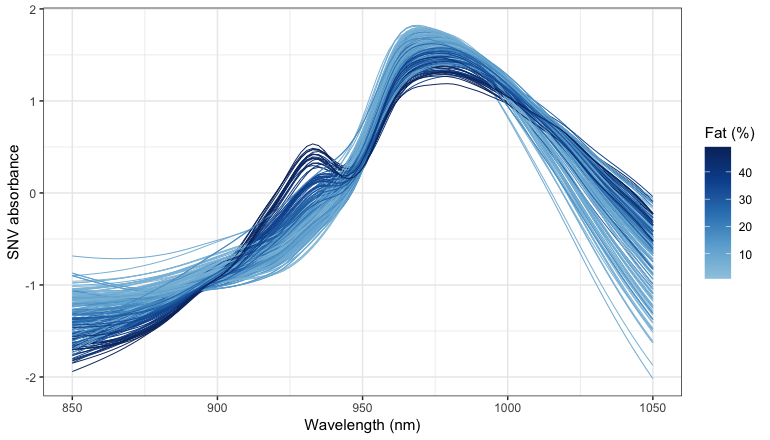

# Horseshoe effect: Unfolding the arch in NIR spectra of meat

The principal component scores of near-infrared (NIR) spectra often lie
on an arch (i.e., horseshoe effect) rather than in a cloud: the spectra
respond nonlinearly to the composition of the samples, and principal
component analysis (PCA), which is linear, bends the main gradient of
composition over two components. Manifold Sculpting is a tool to explore
such structures. This vignette uses it on the NIR spectra of meat to ask
what the arch is, whether it is a genuine curve of the spectra, and what
coordinate runs along it.

The results were computed once, with the code shown here, because some
of the computations take several minutes (see
[Reproducibility](#reproducibility)).

``` r

library(manifoldsculpting) # also attaches recipes
library(dplyr)
library(tidyr)
library(ggplot2)
library(rsample)
library(parsnip)
library(workflows)
library(tune)
library(yardstick)

theme_set(theme_bw(base_size = 10))
blues <- c("#9ecae1", "#6baed6", "#3182bd", "#08519c", "#08306b")
fat_colours <- scale_colour_gradientn(colours = blues, name = "Fat (%)")
```

## The data

The `meats` data of the modeldata package are the Tecator data set
(Borggaard and Thodberg, 1992): 215 samples of finely chopped meat, with
their absorbance spectra measured by transmission at 100 wavelengths
from 850 to 1050 nm, and their water, fat and protein contents (%).

``` r

data(meats, package = "modeldata")
glimpse(meats)
#> Rows: 215
#> Columns: 103
#> $ x_001   <dbl> 2.61776, 2.83454, 2.58284, 2.82286, 2.78813, 3.00993, 2.98893,…
#> $ x_002   <dbl> 2.61814, 2.83871, 2.58458, 2.82460, 2.78989, 3.01540, 2.99435,…
#> $ x_003   <dbl> 2.61859, 2.84283, 2.58629, 2.82630, 2.79167, 3.02086, 2.99980,…
#> $ x_004   <dbl> 2.61912, 2.84705, 2.58808, 2.82814, 2.79350, 3.02634, 3.00540,…
#> $ x_005   <dbl> 2.61981, 2.85138, 2.58996, 2.83001, 2.79538, 3.03190, 3.01117,…
#> $ x_006   <dbl> 2.62071, 2.85587, 2.59192, 2.83192, 2.79746, 3.03756, 3.01716,…
#> $ x_007   <dbl> 2.62186, 2.86060, 2.59401, 2.83392, 2.79984, 3.04341, 3.02347,…
#> $ x_008   <dbl> 2.62334, 2.86566, 2.59627, 2.83606, 2.80254, 3.04955, 3.03014,…
#> $ x_009   <dbl> 2.62511, 2.87093, 2.59873, 2.83842, 2.80553, 3.05599, 3.03708,…
#> $ x_010   <dbl> 2.62722, 2.87661, 2.60131, 2.84097, 2.80890, 3.06274, 3.04445,…
#> $ x_011   <dbl> 2.62964, 2.88264, 2.60414, 2.84374, 2.81272, 3.06982, 3.05213,…
#> $ x_012   <dbl> 2.63245, 2.88898, 2.60714, 2.84664, 2.81704, 3.07724, 3.06032,…
#> $ x_013   <dbl> 2.63565, 2.89577, 2.61029, 2.84975, 2.82184, 3.08511, 3.06905,…
#> $ x_014   <dbl> 2.63933, 2.90308, 2.61361, 2.85307, 2.82710, 3.09343, 3.07841,…
#> $ x_015   <dbl> 2.64353, 2.91097, 2.61714, 2.85661, 2.83294, 3.10231, 3.08846,…
#> $ x_016   <dbl> 2.64825, 2.91953, 2.62089, 2.86038, 2.83945, 3.11185, 3.09918,…
#> $ x_017   <dbl> 2.65350, 2.92873, 2.62486, 2.86437, 2.84664, 3.12205, 3.11059,…
#> $ x_018   <dbl> 2.65937, 2.93863, 2.62909, 2.86860, 2.85458, 3.13294, 3.12265,…
#> $ x_019   <dbl> 2.66585, 2.94929, 2.63361, 2.87308, 2.86331, 3.14457, 3.13566,…
#> $ x_020   <dbl> 2.67281, 2.96072, 2.63835, 2.87789, 2.87280, 3.15703, 3.14936,…
#> $ x_021   <dbl> 2.68008, 2.97272, 2.64330, 2.88301, 2.88291, 3.17038, 3.16331,…
#> $ x_022   <dbl> 2.68733, 2.98493, 2.64838, 2.88832, 2.89335, 3.18429, 3.17695,…
#> $ x_023   <dbl> 2.69427, 2.99690, 2.65354, 2.89374, 2.90374, 3.19840, 3.19001,…
#> $ x_024   <dbl> 2.70073, 3.00833, 2.65870, 2.89917, 2.91371, 3.21225, 3.20256,…
#> $ x_025   <dbl> 2.70684, 3.01920, 2.66375, 2.90457, 2.92305, 3.22552, 3.21496,…
#> $ x_026   <dbl> 2.71281, 3.02990, 2.66880, 2.90991, 2.93187, 3.23827, 3.22788,…
#> $ x_027   <dbl> 2.71914, 3.04101, 2.67383, 2.91521, 2.94060, 3.25084, 3.24197,…
#> $ x_028   <dbl> 2.72628, 3.05345, 2.67892, 2.92043, 2.94986, 3.26393, 3.25812,…
#> $ x_029   <dbl> 2.73462, 3.06777, 2.68411, 2.92565, 2.96035, 3.27851, 3.27652,…
#> $ x_030   <dbl> 2.74416, 3.08416, 2.68937, 2.93082, 2.97241, 3.29514, 3.29661,…
#> $ x_031   <dbl> 2.75466, 3.10221, 2.69470, 2.93604, 2.98606, 3.31401, 3.31746,…
#> $ x_032   <dbl> 2.76568, 3.12106, 2.70012, 2.94128, 3.00097, 3.33458, 3.33822,…
#> $ x_033   <dbl> 2.77679, 3.13983, 2.70563, 2.94658, 3.01652, 3.35591, 3.35857,…
#> $ x_034   <dbl> 2.78790, 3.15810, 2.71141, 2.95202, 3.03220, 3.37709, 3.37882,…
#> $ x_035   <dbl> 2.79949, 3.17623, 2.71775, 2.95777, 3.04793, 3.39772, 3.39971,…
#> $ x_036   <dbl> 2.81225, 3.19519, 2.72490, 2.96419, 3.06413, 3.41828, 3.42189,…
#> $ x_037   <dbl> 2.82706, 3.21584, 2.73344, 2.97159, 3.08153, 3.43974, 3.44511,…
#> $ x_038   <dbl> 2.84356, 3.23747, 2.74327, 2.98045, 3.10078, 3.46266, 3.46814,…
#> $ x_039   <dbl> 2.86106, 3.25889, 2.75433, 2.99090, 3.12185, 3.48663, 3.48887,…
#> $ x_040   <dbl> 2.87857, 3.27835, 2.76642, 3.00284, 3.14371, 3.51002, 3.50519,…
#> $ x_041   <dbl> 2.89497, 3.29384, 2.77931, 3.01611, 3.16510, 3.53087, 3.51543,…
#> $ x_042   <dbl> 2.90924, 3.30362, 2.79272, 3.03048, 3.18470, 3.54711, 3.51885,…
#> $ x_043   <dbl> 2.92085, 3.30681, 2.80649, 3.04579, 3.20140, 3.55699, 3.51619,…
#> $ x_044   <dbl> 2.93015, 3.30393, 2.82064, 3.06194, 3.21477, 3.55986, 3.50972,…
#> $ x_045   <dbl> 2.93846, 3.29700, 2.83541, 3.07889, 3.22544, 3.55656, 3.50259,…
#> $ x_046   <dbl> 2.94771, 3.28925, 2.85121, 3.09686, 3.23505, 3.54937, 3.49802,…
#> $ x_047   <dbl> 2.96019, 3.28409, 2.86872, 3.11629, 3.24586, 3.54169, 3.49875,…
#> $ x_048   <dbl> 2.97831, 3.28505, 2.88905, 3.13775, 3.26027, 3.53692, 3.50653,…
#> $ x_049   <dbl> 3.00306, 3.29326, 2.91289, 3.16217, 3.28063, 3.53823, 3.52275,…
#> $ x_050   <dbl> 3.03506, 3.30923, 2.94088, 3.19068, 3.30889, 3.54760, 3.54677,…
#> $ x_051   <dbl> 3.07428, 3.33267, 2.97325, 3.22376, 3.34543, 3.56512, 3.57737,…
#> $ x_052   <dbl> 3.11963, 3.36251, 3.00946, 3.26172, 3.39019, 3.59043, 3.61244,…
#> $ x_053   <dbl> 3.16868, 3.39661, 3.04780, 3.30379, 3.44198, 3.62229, 3.64869,…
#> $ x_054   <dbl> 3.21771, 3.43188, 3.08554, 3.34793, 3.49800, 3.65830, 3.68262,…
#> $ x_055   <dbl> 3.26254, 3.46492, 3.11947, 3.39093, 3.55407, 3.69515, 3.71139,…
#> $ x_056   <dbl> 3.29988, 3.49295, 3.14696, 3.42920, 3.60534, 3.72932, 3.73360,…
#> $ x_057   <dbl> 3.32847, 3.51458, 3.16677, 3.45998, 3.64789, 3.75803, 3.74947,…
#> $ x_058   <dbl> 3.34899, 3.53004, 3.17938, 3.48227, 3.68011, 3.78003, 3.76022,…
#> $ x_059   <dbl> 3.36342, 3.54067, 3.18631, 3.49687, 3.70272, 3.79560, 3.76731,…
#> $ x_060   <dbl> 3.37379, 3.54797, 3.18924, 3.50558, 3.71815, 3.80614, 3.77206,…
#> $ x_061   <dbl> 3.38152, 3.55306, 3.18950, 3.51026, 3.72863, 3.81313, 3.77511,…
#> $ x_062   <dbl> 3.38741, 3.55675, 3.18801, 3.51221, 3.73574, 3.81774, 3.77666,…
#> $ x_063   <dbl> 3.39164, 3.55921, 3.18498, 3.51215, 3.74059, 3.82079, 3.77696,…
#> $ x_064   <dbl> 3.39418, 3.56045, 3.18039, 3.51036, 3.74357, 3.82258, 3.77594,…
#> $ x_065   <dbl> 3.39490, 3.56034, 3.17411, 3.50682, 3.74453, 3.82301, 3.77346,…
#> $ x_066   <dbl> 3.39366, 3.55876, 3.16611, 3.50140, 3.74336, 3.82206, 3.76953,…
#> $ x_067   <dbl> 3.39045, 3.55571, 3.15641, 3.49398, 3.73991, 3.81959, 3.76426,…
#> $ x_068   <dbl> 3.38541, 3.55132, 3.14512, 3.48457, 3.73418, 3.81557, 3.75787,…
#> $ x_069   <dbl> 3.37869, 3.54585, 3.13241, 3.47333, 3.72638, 3.81021, 3.75055,…
#> $ x_070   <dbl> 3.37041, 3.53950, 3.11843, 3.46041, 3.71676, 3.80375, 3.74243,…
#> $ x_071   <dbl> 3.36073, 3.53235, 3.10329, 3.44595, 3.70553, 3.79642, 3.73368,…
#> $ x_072   <dbl> 3.34979, 3.52442, 3.08714, 3.43005, 3.69289, 3.78835, 3.72442,…
#> $ x_073   <dbl> 3.33769, 3.51583, 3.07014, 3.41285, 3.67900, 3.77958, 3.71475,…
#> $ x_074   <dbl> 3.32443, 3.50668, 3.05237, 3.39450, 3.66396, 3.77024, 3.70463,…
#> $ x_075   <dbl> 3.31013, 3.49700, 3.03393, 3.37511, 3.64785, 3.76040, 3.69406,…
#> $ x_076   <dbl> 3.29487, 3.48683, 3.01504, 3.35482, 3.63085, 3.75005, 3.68318,…
#> $ x_077   <dbl> 3.27891, 3.47626, 2.99569, 3.33376, 3.61305, 3.73929, 3.67229,…
#> $ x_078   <dbl> 3.26232, 3.46552, 2.97612, 3.31204, 3.59463, 3.72831, 3.66175,…
#> $ x_079   <dbl> 3.24542, 3.45501, 2.95642, 3.28986, 3.57582, 3.71738, 3.65160,…
#> $ x_080   <dbl> 3.22828, 3.44481, 2.93660, 3.26730, 3.55695, 3.70681, 3.64173,…
#> $ x_081   <dbl> 3.21080, 3.43477, 2.91667, 3.24442, 3.53796, 3.69664, 3.63191,…
#> $ x_082   <dbl> 3.19287, 3.42465, 2.89655, 3.22117, 3.51880, 3.68659, 3.62177,…
#> $ x_083   <dbl> 3.17433, 3.41419, 2.87622, 3.19757, 3.49936, 3.67649, 3.61102,…
#> $ x_084   <dbl> 3.15503, 3.40303, 2.85563, 3.17357, 3.47938, 3.66611, 3.59929,…
#> $ x_085   <dbl> 3.13475, 3.39082, 2.83474, 3.14915, 3.45869, 3.65503, 3.58642,…
#> $ x_086   <dbl> 3.11339, 3.37731, 2.81361, 3.12429, 3.43711, 3.64283, 3.57249,…
#> $ x_087   <dbl> 3.09116, 3.36265, 2.79235, 3.09908, 3.41458, 3.62938, 3.55803,…
#> $ x_088   <dbl> 3.06850, 3.34745, 2.77113, 3.07366, 3.39129, 3.61483, 3.54375,…
#> $ x_089   <dbl> 3.04596, 3.33245, 2.75015, 3.04825, 3.36772, 3.59990, 3.53017,…
#> $ x_090   <dbl> 3.02393, 3.31818, 2.72956, 3.02308, 3.34450, 3.58535, 3.51747,…
#> $ x_091   <dbl> 3.00247, 3.30473, 2.70934, 2.99820, 3.32201, 3.57163, 3.50544,…
#> $ x_092   <dbl> 2.98145, 3.29186, 2.68951, 2.97367, 3.30025, 3.55877, 3.49372,…
#> $ x_093   <dbl> 2.96072, 3.27921, 2.67009, 2.94951, 3.27907, 3.54651, 3.48197,…
#> $ x_094   <dbl> 2.94013, 3.26655, 2.65112, 2.92576, 3.25831, 3.53442, 3.46996,…
#> $ x_095   <dbl> 2.91978, 3.25369, 2.63262, 2.90251, 3.23784, 3.52221, 3.45756,…
#> $ x_096   <dbl> 2.89966, 3.24045, 2.61461, 2.87988, 3.21765, 3.50972, 3.44456,…
#> $ x_097   <dbl> 2.87964, 3.22659, 2.59718, 2.85794, 3.19766, 3.49682, 3.43070,…
#> $ x_098   <dbl> 2.85960, 3.21181, 2.58034, 2.83672, 3.17770, 3.48325, 3.41583,…
#> $ x_099   <dbl> 2.83940, 3.19600, 2.56404, 2.81617, 3.15770, 3.46870, 3.40018,…
#> $ x_100   <dbl> 2.81920, 3.17942, 2.54816, 2.79622, 3.13753, 3.45307, 3.38415,…
#> $ water   <dbl> 60.50, 46.00, 71.00, 72.80, 58.30, 44.00, 44.00, 69.30, 61.40,…
#> $ fat     <dbl> 22.5, 40.1, 8.4, 5.9, 25.5, 42.7, 42.7, 10.6, 19.9, 19.9, 46.0…
#> $ protein <dbl> 16.7, 13.5, 20.5, 20.7, 15.5, 13.7, 13.7, 19.3, 17.7, 17.7, 12…
```

In long format, with one row per sample and wavelength, the spectra are
easy to transform and to plot:

``` r

wavelengths <- seq(850, 1050, length.out = 100)

spectra <- meats |>
  mutate(sample = row_number()) |>
  pivot_longer(
    starts_with("x_"),
    names_to = "channel",
    values_to = "absorbance"
    ) |>
  mutate(wavelength = wavelengths[as.integer(sub("x_", "", channel))])

spectra
#> # A tibble: 21,500 × 7
#>    water   fat protein sample channel absorbance wavelength
#>    <dbl> <dbl>   <dbl>  <int> <chr>        <dbl>      <dbl>
#>  1  60.5  22.5    16.7      1 x_001         2.62       850 
#>  2  60.5  22.5    16.7      1 x_002         2.62       852.
#>  3  60.5  22.5    16.7      1 x_003         2.62       854.
#>  4  60.5  22.5    16.7      1 x_004         2.62       856.
#>  5  60.5  22.5    16.7      1 x_005         2.62       858.
#>  6  60.5  22.5    16.7      1 x_006         2.62       860.
#>  7  60.5  22.5    16.7      1 x_007         2.62       862.
#>  8  60.5  22.5    16.7      1 x_008         2.62       864.
#>  9  60.5  22.5    16.7      1 x_009         2.63       866.
#> 10  60.5  22.5    16.7      1 x_010         2.63       868.
#> # ℹ 21,490 more rows
```

``` r

ggplot(spectra) +
  aes(wavelength, absorbance, group = sample, colour = fat) +
  geom_line(linewidth = 0.3) +
  fat_colours +
  labs(x = "Wavelength (nm)", y = "Absorbance")
```


NIR spectra of the 215 meat samples, colored by their fat content.

The spectra differ mostly by vertical offsets, caused by light
scattering in samples of different texture, which have little to do with
their composition. The composition itself has only two degrees of
freedom, since water, fat and protein add up to about 99%. Fat varies
the most, from 1% to 49%, and water and protein decrease as it increases
(correlations of -0.99 and -0.86).

``` r

ggplot(meats) +
  aes(fat, protein) +
  geom_point(size = 1.5, colour = last(blues), alpha = 0.7) +
  labs(x = "Fat (%)", y = "Protein (%)")
```


Protein and fat contents of the samples.

## Scatter correction

The standard normal variate (SNV) transformation (Barnes et al., 1989)
removes most of the scatter: each spectrum is centered and scaled by its
own mean and standard deviation.

``` r

spectra <- spectra |>
  group_by(sample) |>
  mutate(snv = (absorbance - mean(absorbance)) / sd(absorbance)) |>
  ungroup()

meats_snv <- spectra |>
  select(sample, water, fat, protein, channel, snv) |>
  pivot_wider(names_from = channel, values_from = snv) |>
  select(-sample)
```

``` r

ggplot(spectra) +
  aes(wavelength, snv, group = sample, colour = fat) +
  geom_line(linewidth = 0.3) +
  fat_colours +
  labs(x = "Wavelength (nm)", y = "SNV absorbance")
```



The spectra after the SNV transformation.

## The arch

The recipes share a first step: protein is the outcome, water and fat
are kept for the plots but are not predictors, and the spectra are
centered.

``` r

base_recipe <- function(data) {
  recipe(protein ~ ., data = data) |>
    update_role(water, fat, new_role = "composition") |>
    step_center(all_predictors())
}

pca_raw <- base_recipe(meats) |>
  step_pca(all_predictors(), num_comp = 2) |>
  prep()
pca_snv <- base_recipe(meats_snv) |>
  step_pca(all_predictors(), num_comp = 2) |>
  prep()

# Percentage of variance of the first three components
variance <- bind_rows(
  raw = tidy(pca_raw, number = 2, type = "variance"),
  SNV = tidy(pca_snv, number = 2, type = "variance"),
  .id = "spectra"
) |>
  filter(terms == "percent variance", component <= 3) |>
  pivot_wider(names_from = component, names_prefix = "PC", values_from = value) |>
  select(spectra, PC1, PC2, PC3)
variance
#> # A tibble: 2 × 4
#>   spectra   PC1    PC2   PC3
#>   <chr>   <dbl>  <dbl> <dbl>
#> 1 raw      98.7  0.901 0.296
#> 2 SNV      68.1 29.1   1.63
```

``` r

pca_scores <- bind_rows(
  "Raw spectra" = bake(pca_raw, new_data = NULL),
  "SNV spectra" = bake(pca_snv, new_data = NULL),
  .id = "spectra"
)

ggplot(pca_scores, aes(PC1, PC2, colour = fat)) +
  geom_point(size = 1.5) +
  facet_wrap(~spectra, scales = "free") +
  fat_colours
```


Scores of the first two principal components of the raw and the SNV
spectra, colored by fat content.

On the raw spectra, the first component is the scatter, with 98.7% of
the variance, and the fat contents are mixed up. After the SNV
transformation, the first two components carry 68% and 29% of the
variance, and the scores lie on an **arch**. Fat runs along it, from the
leanest samples at the end of the left arm, over the top, to the fattest
at the end of the right arm. The fat content of a sample is given by its
position along the arch, and neither component follows it on its own:
this is the horseshoe effect of ordination methods (Diaconis et al.,
2008), where one dominant nonlinear gradient is bent over two
components.

## Two dimensions keep the arch

[`step_manifold_sculpting()`](https://christiangoueguel.com/manifold-sculpting/reference/step_manifold_sculpting.md)
replaces
[`step_pca()`](https://recipes.tidymodels.org/reference/step_pca.html)
in the same recipe. It looks for coordinates that preserve the distances
and angles between neighboring spectra (20 neighbors here), with the
best of three runs:

``` r

ms_snv <- base_recipe(meats_snv) |>
  step_manifold_sculpting(
    all_predictors(),
    num_comp = 2,
    neighbors = 20,
    options = list(nstart = 3),
    seed = 1
    ) |>
  prep()

pca_snv_scores <- bake(pca_snv, new_data = NULL)
ms_scores <- bake(ms_snv, new_data = NULL)
ms_scores |> select(MS1, MS2, water, fat, protein)
#> # A tibble: 215 × 5
#>       MS1    MS2 water   fat protein
#>     <dbl>  <dbl> <dbl> <dbl>   <dbl>
#>  1  0.364  0.904  60.5  22.5    16.7
#>  2 -2.40   1.15   46    40.1    13.5
#>  3  0.959 -3.04   71     8.4    20.5
#>  4  1.44  -2.07   72.8   5.9    20.7
#>  5 -0.317  1.48   58.3  25.5    15.5
#>  6 -2.66   1.72   44    42.7    13.7
#>  7 -2.96   0.813  44    42.7    13.7
#>  8  1.02   0.650  69.3  10.6    19.3
#>  9 -0.705  1.13   61.4  19.9    17.7
#> 10 -0.764  0.490  61.4  19.9    17.7
#> # ℹ 205 more rows
```

``` r

# Rotate (and reflect) a configuration onto a target, by Procrustes analysis
procrustes <- function(x, target) {
  x <- scale(x, scale = FALSE)
  s <- svd(crossprod(x, scale(target, scale = FALSE)))
  x %*% s$u %*% t(s$v)
}
rotated <- procrustes(
  as.matrix(select(ms_scores, MS1, MS2)),
  as.matrix(select(pca_snv_scores, PC1, PC2))
  )

method_levels <- c("PCA", "Manifold Sculpting", "Manifold Sculpting, rotated")
bind_rows(
  "PCA" = pca_snv_scores |> rename(dim_1 = PC1, dim_2 = PC2),
  "Manifold Sculpting" = ms_scores |> rename(dim_1 = MS1, dim_2 = MS2),
  "Manifold Sculpting, rotated" = ms_scores |> mutate(dim_1 = rotated[, 1], dim_2 = rotated[, 2]),
  .id = "method"
) |>
  mutate(method = factor(method, levels = method_levels)) |>
  ggplot(aes(dim_1, dim_2, colour = fat)) +
  geom_point(size = 1.5) +
  facet_wrap(~method, scales = "free") +
  fat_colours +
  labs(x = "First dimension", y = "Second dimension")
```


PCA scores and two-dimensional Manifold Sculpting embedding of the SNV
spectra, as computed and rotated onto the PCA scores, colored by fat
content.

The embedding looks different from the PCA scores, but the orientation
and the scale of the axes of an embedding are arbitrary, and only its
shape matters. Rotated onto the PCA scores (right), it is the same arch:
each dimension of the embedding is almost exactly a linear combination
of the first two principal components.

``` r

# Share of each dimension of the embedding explained by PC1 and PC2
two_d <- bind_cols(ms_scores |> select(MS1, MS2), pca_snv_scores |> select(PC1, PC2))
two_d_r2 <- c(
  MS1 = summary(lm(MS1 ~ PC1 + PC2, data = two_d))$r.squared,
  MS2 = summary(lm(MS2 ~ PC1 + PC2, data = two_d))$r.squared
)
round(two_d_r2, 3)
#>   MS1   MS2 
#> 0.993 0.996
```

This is how Manifold Sculpting should behave. It preserves the geometry
of neighborhoods, and an arch that lies in a plane already has room to
keep it in two dimensions: straightening the arch would stretch its
outer edge and compress its inner one. The method unfolds a structure
only when the number of dimensions forces it to, as for the Swiss roll,
a sheet rolled up in three dimensions that is laid flat in two. The
agreement with PCA is thus a finding in itself: the arch is a genuine
curve of the spectra, lying in the plane of the first two components
(which carry 97% of the variance), and not the shadow of a structure
folded in more dimensions, which a projection would hide.

## One dimension unfolds it

The arch is a single gradient bent in two dimensions, and with one
dimension, Manifold Sculpting has to unfold it. The
[`manifold_sculpting()`](https://christiangoueguel.com/manifold-sculpting/reference/manifold_sculpting.md)
function computes the embedding directly from the matrix of SNV spectra:

``` r

snv <- as.matrix(select(meats_snv, starts_with("x_")))

# The sign of an embedding is arbitrary: orient it so that it increases with fat
along_fat <- function(x) x * sign(cor(x, meats_snv$fat))

set.seed(1)
ms_1d <- manifold_sculpting(snv, ndim = 1, neighbors = 20, nstart = 3)
ms_1d
#> Manifold Sculpting embedding
#> * 215 samples, 100 variables to 1 dimension
#> * 20 neighbors, squishing rate 0.99
#> * 549 iterations (converged), final error 1357
#> * Best of 3 runs, with final errors 1357, 1475, 1571

coordinates <- pca_snv_scores |>
  select(PC1, PC2, water, fat, protein) |>
  mutate(MS = along_fat(ms_1d$embedding[, 1]), PC1_fat = along_fat(PC1))
```

``` r

ggplot(coordinates) +
  aes(PC1_fat, MS, colour = fat) +
  geom_point(size = 1.5) +
  fat_colours +
  labs(x = "First principal component", y = "Manifold Sculpting, 1 dimension")
```


The one-dimensional Manifold Sculpting embedding against the first
principal component, colored by fat content.

The two coordinates agree at the lean end of the arch, but not where it
turns. The first principal component projects the samples across the
arch, so that samples at its top and on its steep right arm can have the
same score. The embedding follows the arch, and places the leaner
samples of the top before the fatter samples of the arm, which sit above
them in the plot. It is therefore closer to the gradient of composition:

``` r

first_dimension <- coordinates |>
  pivot_longer(c(PC1_fat, MS), names_to = "method", values_to = "dimension") |>
  mutate(method = factor(method, levels = c("PC1_fat", "MS"),
                         labels = c("PC1", "Manifold Sculpting, 1 dimension"))) |>
  pivot_longer(c(water, fat, protein), names_to = "constituent", values_to = "percent") |>
  mutate(constituent = factor(constituent, levels = c("water", "fat", "protein")))

# Share of the variance of each constituent explained by a straight line
linearity <- first_dimension |>
  group_by(constituent, method) |>
  summarise(r_squared = cor(dimension, percent)^2, .groups = "drop") |>
  pivot_wider(names_from = method, values_from = r_squared)
linearity
#> # A tibble: 3 × 3
#>   constituent   PC1 `Manifold Sculpting, 1 dimension`
#>   <fct>       <dbl>                             <dbl>
#> 1 water       0.505                             0.739
#> 2 fat         0.453                             0.691
#> 3 protein     0.320                             0.371
```

``` r

ggplot(first_dimension, aes(dimension, percent)) +
  geom_point(size = 1, colour = last(blues), alpha = 0.6) +
  geom_smooth(method = "lm", formula = y ~ x, se = FALSE, colour = "#eb6834", linewidth = 0.6) +
  facet_grid(constituent ~ method, scales = "free") +
  labs(x = NULL, y = "Content (%)")
```


Contents against the first principal component and against the
one-dimensional Manifold Sculpting embedding, with a straight-line fit.

A straight line on the one-dimensional embedding explains 74% of the
variance of water and 69% of fat, against 51% and 45% for the first
principal component, whose relation with the contents bends at the ends
of the arch. Protein gains less (37% against 32%): it decreases as fat
increases, but it is not a function of the fat and water gradient alone.
No reference value was used to obtain this coordinate.

## How stable is the coordinate?

An exploratory embedding is only useful if its features do not depend on
the settings. The coordinate is computed again with 10 to 45 neighbors:

``` r

k_values <- c(10, 20, 30, 45)
stability <- lapply(k_values, function(k) {
  set.seed(1)
  fit <- manifold_sculpting(snv, ndim = 1, neighbors = k, nstart = 3)
  tibble(
    neighbors = k,
    sample = seq_len(nrow(snv)),
    MS = along_fat(fit$embedding[, 1])
    )
  }) |>
  bind_rows() |>
  left_join(
    coordinates |> mutate(sample = row_number()),
    by = "sample",
    suffix = c("", "_20")
    )

stability_summary <- stability |>
  group_by(neighbors) |>
  summarise(
    rank_cor_k20 = cor(MS, MS_20, method = "spearman"),
    r2_water = cor(MS, water)^2,
    r2_fat = cor(MS, fat)^2,
    r2_protein = cor(MS, protein)^2
  )
stability_summary
#> # A tibble: 4 × 5
#>   neighbors rank_cor_k20 r2_water r2_fat r2_protein
#>       <dbl>        <dbl>    <dbl>  <dbl>      <dbl>
#> 1        10        0.969    0.738  0.686      0.400
#> 2        20        1        0.739  0.691      0.371
#> 3        30        0.875    0.525  0.469      0.322
#> 4        45        0.935    0.643  0.587      0.372
```

``` r

stability |>
  filter(neighbors != 20) |>
  mutate(neighbors = factor(neighbors, levels = k_values, labels = paste(k_values, "neighbors"))) |>
  ggplot(aes(MS_20, MS, colour = fat)) +
  geom_point(size = 1) +
  facet_wrap(~neighbors, scales = "free_y") +
  fat_colours +
  labs(x = "Embedding with 20 neighbors", y = "Embedding")
```


One-dimensional embeddings computed with 10, 30 and 45 neighbors,
against the embedding computed with 20 neighbors, colored by fat
content.

The order of the samples is stable: whatever the number of neighbors,
the coordinate ranks them nearly as with 20 neighbors (a rank
correlation of at least 0.88). How evenly it spreads them varies more,
as the bends in the plots show, and with it the share of the variance of
water that a straight line explains, from 52% to 74% (against 51% for
the first principal component). Trying a few numbers of neighbors, as
here, tells which features of an embedding can be trusted.

## What drives the coordinate

Manifold Sculpting has no loadings, but the correlation between the SNV
absorbance at each wavelength and the coordinate shows which parts of
the spectra it follows. The same correlations with the first principal
component and with the fat content are shown for comparison:

``` r

profiles <- tibble(
  wavelength = wavelengths,
  "Manifold Sculpting" = cor(snv, coordinates$MS)[, 1],
  "PC1" = cor(snv, coordinates$PC1_fat)[, 1],
  "Fat content" = cor(snv, meats_snv$fat)[, 1]
)

# How closely the profile of each coordinate follows that of fat
profile_fit <- c(
  "Manifold Sculpting" = cor(profiles[["Manifold Sculpting"]], profiles[["Fat content"]]),
  "PC1" = cor(profiles$PC1, profiles[["Fat content"]])
)
round(profile_fit, 3)
#> Manifold Sculpting                PC1 
#>              0.986              0.850
peak <- profiles$wavelength[which.max(profiles[["Manifold Sculpting"]])]
```

``` r

profiles_long <- profiles |>
  pivot_longer(-wavelength, names_to = "variable", values_to = "r") |>
  mutate(variable = factor(variable, levels = c("Manifold Sculpting", "PC1", "Fat content")))

ggplot(profiles_long, aes(wavelength, r, colour = variable, linetype = variable)) +
  geom_hline(yintercept = 0, colour = "grey80") +
  geom_vline(xintercept = c(930, 970), colour = "grey60", linetype = "dotted") +
  annotate("text", x = c(930, 970), y = -1.08, label = c("fat, 930 nm", "water, 970 nm"),
           size = 3, colour = "grey30") +
  geom_line(linewidth = 0.8) +
  scale_colour_manual(values = c("#2a78d6", "#eb6834", "grey30")) +
  scale_linetype_manual(values = c("solid", "solid", "dashed")) +
  labs(x = "Wavelength (nm)", y = "Correlation", colour = NULL, linetype = NULL) +
  theme(legend.position = "top")
```


Correlation between the SNV absorbance at each wavelength and the
one-dimensional embedding, the first principal component and the fat
content.

The profile of the coordinate is almost that of the fat content (a
correlation of 0.99 between the two profiles, against 0.85 for the first
principal component), with its maximum at 929 nm, at the absorption band
of fat near 930 nm (third overtone of the C–H stretching vibration). The
coordinate is the gradient of fat against water, while the first
principal component mixes it with the bending of the arch.

## What unfolding does not do

The coordinate follows the main gradient of composition, without any
reference value. Does unfolding also help to predict a minor constituent
such as protein? Principal component regression and its Manifold
Sculpting analog, a linear regression on 1 to 6 dimensions, are compared
by 10-fold cross-validation, with 20 neighbors as above and with 60:

``` r

set.seed(2026)
folds <- vfold_cv(meats_snv, v = 10, strata = protein)

pca_wflow <- workflow(
  base_recipe(meats_snv) |> step_pca(all_predictors(), num_comp = tune()),
  linear_reg()
)
ms_wflow <- workflow(
  base_recipe(meats_snv) |>
    step_manifold_sculpting(
      all_predictors(),
      num_comp = tune(),
      neighbors = tune(),
      options = list(nstart = 3), seed = 1),
  linear_reg()
  )

pca_cv <- tune_grid(
  pca_wflow,
  resamples = folds,
  grid = tibble(num_comp = 1:6), metrics = metric_set(rmse)
  )

ms_cv <- tune_grid(
  ms_wflow,
  resamples = folds,
  grid = crossing(num_comp = 1:6, neighbors = c(20, 60)), metrics = metric_set(rmse)
  )

cv_results <- bind_rows(
  collect_metrics(pca_cv) |> mutate(model = "PCA"),
  collect_metrics(ms_cv) |> mutate(model = paste0("MS, k = ", neighbors))
) |>
  mutate(model = factor(model, levels = c("PCA", "MS, k = 20", "MS, k = 60")))
cv_results |>
  group_by(model) |>
  slice_min(mean, n = 1) |>
  select(model, num_comp, rmse = mean, std_err)
#> # A tibble: 3 × 4
#> # Groups:   model [3]
#>   model      num_comp  rmse std_err
#>   <fct>         <int> <dbl>   <dbl>
#> 1 PCA               5  1.26  0.0793
#> 2 MS, k = 20        4  1.78  0.122 
#> 3 MS, k = 60        6  1.26  0.0752
```

``` r

ggplot(cv_results, aes(num_comp, mean, colour = model)) +
  geom_line(linewidth = 0.8) +
  geom_point(size = 2) +
  scale_colour_manual(values = c("#2a78d6", "#eb6834", "#1baf7a")) +
  scale_x_continuous(breaks = 1:6) +
  labs(x = "Number of dimensions", y = "Cross-validated RMSE (%)", colour = NULL) +
  theme(legend.position = "top")
```


Cross-validated RMSE of the protein predictions against the number of
dimensions.

With the 20 neighbors that unfold the arch, the regression on the
embedding is clearly worse than principal component regression (a
cross-validated RMSE of 1.78 at best, against 1.26). With 60 neighbors,
it is as accurate (1.26). Protein absorbs weakly between 850 and 1050
nm, where the bands of water and fat dominate, and much of its signal is
in directions of small variance: the third principal component, with
1.6% of the variance, reduces the RMSE of principal component regression
from 2.29 to 1.31. Manifold Sculpting, which preserves the geometry of
neighborhoods, keeps such small variations only with large
neighborhoods, where it behaves like a global method. For the
calibration of a minor constituent, a linear model on enough components,
such as principal component regression or partial least squares, is as
accurate and simpler.

## What we see

- **The arch is the gradient of fat.** Once the scatter is removed, the
  PCA scores lie on an arch, along which fat increases from one end to
  the other: one nonlinear gradient bent over two components.
- **Two dimensions keep the arch.** The two-dimensional embedding has
  the shape of the PCA scores: the arch is a genuine curve of the
  spectra, lying in a plane, which Manifold Sculpting has no reason to
  straighten.
- **One dimension unfolds it.** The one-dimensional embedding orders the
  samples along the arch, and its profile over the wavelengths is that
  of fat. With 20 neighbors, it follows water and fat much more closely
  than the first principal component; its order is stable across numbers
  of neighbors, but how much closer it is varies.
- **Unfolding is not calibration.** The embedding does not predict
  protein better than the principal components, and matches them only
  with large neighborhoods.

Manifold Sculpting is thus an exploratory tool for spectra: it tells
whether a curved structure in a score plot is genuine, and gives a
coordinate along it without reference values. The same approach applies
whenever spectra follow one curved path, as in the monitoring of a
process, a reaction or the ripening of a product over time, where such a
coordinate can track progress before any reference analysis is
available.

## Reproducibility

The vignette was computed with the following versions:

| Package           | Version |
|:------------------|:--------|
| manifoldsculpting | 1.2.1   |
| modeldata         | 1.6.0   |
| recipes           | 1.4.0   |
| rsample           | 1.3.2   |
| parsnip           | 1.6.1   |
| workflows         | 1.3.0   |
| tune              | 2.1.0   |
| yardstick         | 1.4.0   |
| dplyr             | 1.2.1   |
| tidyr             | 1.3.2   |
| ggplot2           | 4.0.3   |

To compute it again, install these packages and run
`vignettes/precompute.R` from the source of the package. It knits
`vignettes/spectroscopy.Rmd.orig`, which holds the code, into
`vignettes/spectroscopy.Rmd`.

## References

Barnes, R. J., Dhanoa, M. S. and Lister, S. J. (1989). Standard normal
variate transformation and de-trending of near-infrared diffuse
reflectance spectra. *Applied Spectroscopy*, 43, 772–777.

Borggaard, C. and Thodberg, H. H. (1992). Optimal minimal neural
interpretation of spectra. *Analytical Chemistry*, 64, 545–551.

Diaconis, P., Goel, S. and Holmes, S. (2008). Horseshoes in
multidimensional scaling and local kernel methods. *The Annals of
Applied Statistics*, 2, 777–807.

Gashler, M., Ventura, D. and Martinez, T. (2008). Iterative non-linear
dimensionality reduction with manifold sculpting. In *Advances in Neural
Information Processing Systems 20*, 513–520.
