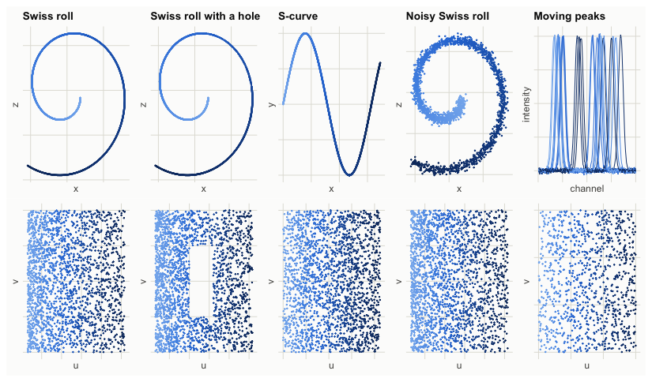
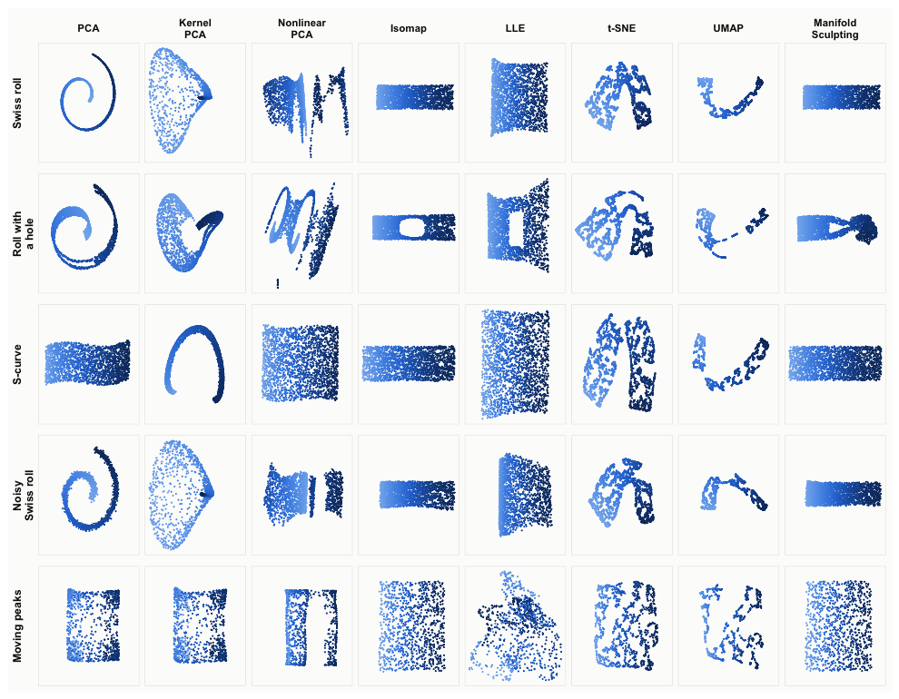
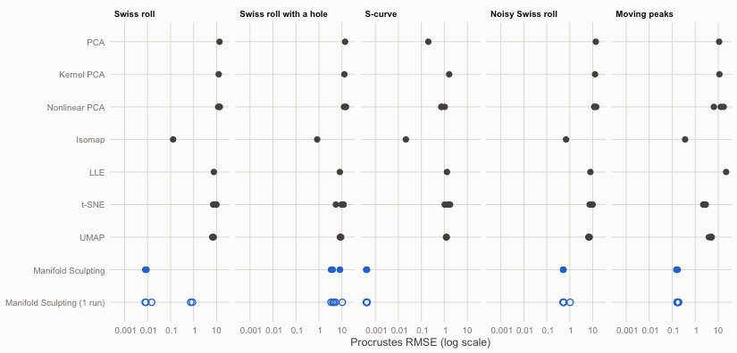
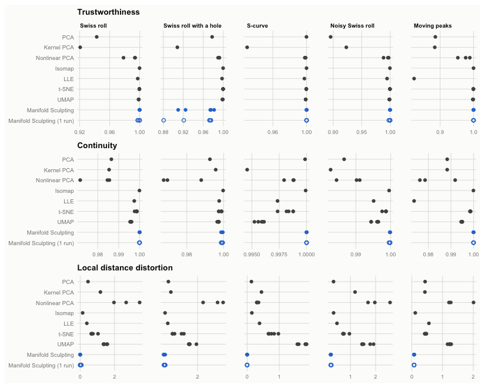
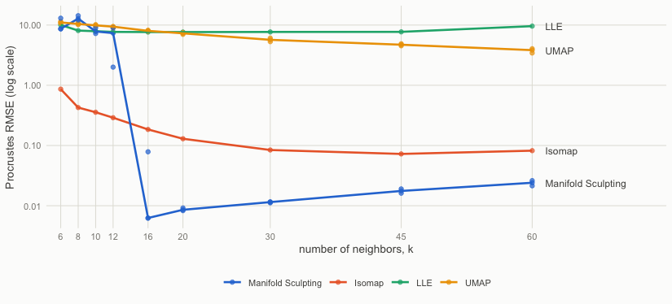
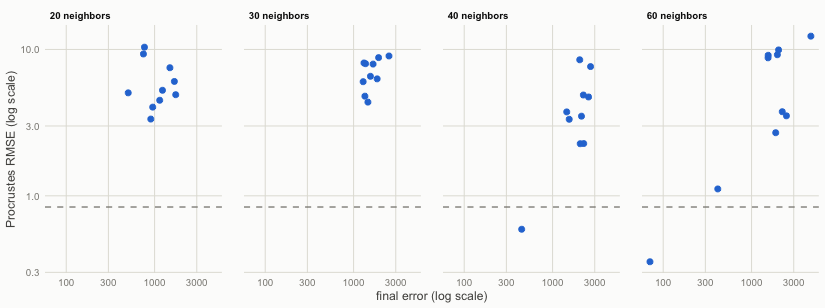
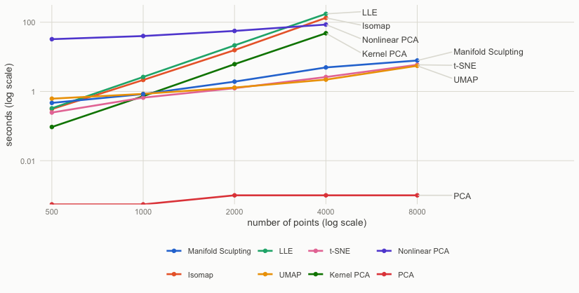

This vignette compares Manifold Sculpting with the standard R
implementations of six other nonlinear dimensionality reduction methods,
and with principal component analysis (PCA) as a linear baseline. The
methods are run on five test problems whose intrinsic coordinates are
known, so that the quality of each embedding can be measured. The
comparison covers the accuracy of the embeddings, the preservation of
neighborhoods and local distances, the sensitivity to the number of
neighbors, the computing time, and the embedding of new samples.

The results were computed once, with the code shown here, because the
comparison takes about an hour and needs packages that manifoldsculpting
does not depend on (see [Reproducibility](#reproducibility)).


``` r
library(manifoldsculpting)
library(ggplot2)
library(patchwork)
```

## The methods

| Method | Implementation | Settings | New samples |
|:-------|:---------------|:---------|:-----------:|
| PCA | stats, `prcomp()` | | yes |
| Kernel PCA (Schölkopf et al., 1998) | kernlab, `kpca()` | Gaussian kernel, width chosen from a grid (best result kept) | yes |
| Nonlinear PCA (Kramer, 1991; Scholz et al., 2005) | pcaMethods, `pca(method = "nlpca")` | default network, 5000 training steps | no |
| Isomap (Tenenbaum et al., 2000) | vegan, `isomap()` | 20 neighbors | no |
| LLE (Roweis and Saul, 2000) | Rdimtools, `do.lle()` | 20 neighbors, regularization $10^{-3}$ times the trace of the local Gram matrix | no |
| t-SNE (van der Maaten and Hinton, 2008) | Rtsne, `Rtsne()` | perplexity 30 (Barnes-Hut) | no |
| UMAP (McInnes et al., 2018) | uwot, `umap()` | 20 neighbors | yes |
| Manifold Sculpting (Gashler et al., 2008) | manifoldsculpting, `manifold_sculpting()` | 20 neighbors, best of 3 runs (`nstart = 3`) | yes |

The four methods built on a neighborhood graph (Isomap, LLE, UMAP and
Manifold Sculpting) use the same number of neighbors, 20; their
sensitivity to this choice is studied [below](#number-of-neighbors). The
other settings are the defaults of each implementation, with three
exceptions:

- Kernel PCA has no default kernel width that adapts to the scale of the
  data. The width is chosen, for each problem, from a grid of five values
  scaled by the median squared distance between samples, and the best
  result (measured against the true coordinates) is kept. This gives
  kernel PCA an advantage that the other methods do not get.
- The nonlinear PCA network (an autoassociative neural network, of which
  pcaMethods trains the decoder part) is trained for 5000 steps instead of
  its default of twice the number of values in the data, to keep the
  computing time reasonable; longer training did not improve the
  results on the Swiss roll. With more than 10 variables, it is trained on
  the first 10 principal components.
- The regularization of LLE is set to the usual $10^{-3}$ times the trace
  of the local Gram matrix (as in scikit-learn). The default of Rdimtools
  is a fixed value, which depends on the scale of the data.

All the methods run on a single thread. t-SNE, UMAP, nonlinear PCA and
Manifold Sculpting are stochastic: they are run with 5 seeds (3 for
nonlinear PCA, the slowest), and Manifold Sculpting is also run alone
(`nstart = 1`, labeled "1 run") to show the reliability of single runs.


``` r
k <- 20 # neighbors for Isomap, LLE, UMAP and Manifold Sculpting

methods <- list(
  "PCA" = function(x, ...) {
    prcomp(x)$x[, 1:2]
  },
  "Kernel PCA" = function(x, sigma, ...) {
    fit <- kernlab::kpca(x, kernel = "rbfdot", kpar = list(sigma = sigma), features = 2)
    kernlab::rotated(fit)
  },
  "Nonlinear PCA" = function(x, ...) {
    if (ncol(x) > 10) x <- prcomp(x, rank. = 10)$x
    fit <- pcaMethods::pca(x, method = "nlpca", nPcs = 2, maxSteps = 5000, verbose = FALSE)
    pcaMethods::scores(fit)
  },
  "Isomap" = function(x, k, ...) {
    vegan::isomap(dist(x), ndim = 2, k = k)$points
  },
  "LLE" = function(x, k, ...) {
    reg <- 1e-3 * k * mean(FNN::get.knn(x, k)$nn.dist^2)
    Rdimtools::do.lle(x, ndim = 2, type = c("knn", k), symmetric = "asymmetric",
                      regparam = reg)$Y
  },
  "t-SNE" = function(x, ...) {
    Rtsne::Rtsne(x, dims = 2, perplexity = 30, check_duplicates = FALSE, num_threads = 1)$Y
  },
  "UMAP" = function(x, k, ...) {
    uwot::umap(x, n_neighbors = k, n_components = 2, n_threads = 1)
  },
  "Manifold Sculpting" = function(x, k, ...) {
    manifold_sculpting(x, ndim = 2, neighbors = k, nstart = 3)$embedding
  },
  "Manifold Sculpting (1 run)" = function(x, k, ...) {
    manifold_sculpting(x, ndim = 2, neighbors = k, nstart = 1)$embedding
  }
)
seeds <- list("t-SNE" = 1:5, "UMAP" = 1:5, "Nonlinear PCA" = 1:3,
              "Manifold Sculpting" = 1:5, "Manifold Sculpting (1 run)" = 1:5)
kernel_grid <- c(1, 3, 10, 30, 100) # kernel PCA: sigma = grid / median squared distance
```

## The test problems

Four problems are the manifolds of the paper of Gashler et al. (2008),
simulated by `sim_swiss_roll()` and `sim_s_curve()`:

- **Swiss roll**: 2000 points on a sheet rolled up in three dimensions.
- **Swiss roll with a hole**: the same roll with a rectangular region of
  the sheet left empty, a sampling hole that is known to distort the
  geodesic distances of Isomap.
- **S-curve**: 2000 points on a sheet bent into a sine wave.
- **Noisy Swiss roll**: the Swiss roll with Gaussian noise (standard
  deviation 0.3, about half the distance between neighbors) added to the
  coordinates.

The fifth problem is a high-dimensional manifold, the spectroscopic
analog of the translated images of the paper:

- **Moving peaks**: 1000 spectra of 200 channels, each with two Gaussian
  peaks whose positions vary independently, plus a little noise. The two
  positions are the intrinsic coordinates. Because the peaks have the
  same shape, a shift of either peak changes the spectrum by the same
  amount, so the ideal embedding is a square, but the spectra lie on a
  strongly curved surface: once the peaks no longer overlap, all the
  spectra are about equally far apart.


``` r
spectra <- function(n, channels = 200, width = 5, noise = 0.01) {
  a <- runif(n)
  b <- runif(n)
  peak <- function(center) exp(-0.5 * (outer(center, seq_len(channels), "-") / width)^2)
  x <- peak(30 + 60 * a) + peak(110 + 60 * b) + rnorm(n * channels, sd = noise)
  list(x = x, truth = cbind(u = 60 * a, v = 60 * b))
}

set.seed(2026)
roll <- sim_swiss_roll(2000)
holed <- sim_swiss_roll(2400)
holed <- holed[!(holed$u > 20 & holed$u < 32 & abs(holed$v) < 3), ]
curve <- sim_s_curve(2000)
noisy <- sim_swiss_roll(2000, noise = 0.3)
peaks <- spectra(1000)

as_problem <- function(data) {
  list(x = as.matrix(data[c("x", "y", "z")]), truth = as.matrix(data[c("u", "v")]))
}
problems <- list(
  "Swiss roll" = as_problem(roll),
  "Swiss roll with a hole" = as_problem(holed),
  "S-curve" = as_problem(curve),
  "Noisy Swiss roll" = as_problem(noisy),
  "Moving peaks" = peaks
)
sapply(problems, function(p) dim(p$x))
#>      Swiss roll Swiss roll with a hole S-curve Noisy Swiss roll Moving peaks
#> [1,]       2000                   2137    2000             2000         1000
#> [2,]          3                      3       3                3          200
```




## Measures of quality

Four measures are computed for each embedding $Y$ of data $X$ with intrinsic
coordinates $T$:

- **Procrustes RMSE**, the measure of the paper: the root mean squared
  distance between $T$ and $Y$ after the rotation, scaling and translation
  of $Y$ that bring it closest to $T$. It is expressed in the units of the
  intrinsic coordinates (the Swiss roll is about 49 by 12, the peaks move
  over 60 channels) and measures how well the global shape of the
  manifold is recovered.
- **Trustworthiness** and **continuity** (Venna and Kaski, 2001), with 10
  neighbors. Trustworthiness penalizes points that are neighbors in the
  embedding but not in the data, according to how far they are in the
  data; continuity penalizes data neighbors that are separated in the
  embedding. Both are 1 when the neighborhoods are preserved exactly.
- **Local distance distortion**: the coefficient of variation of the
  ratio between the embedded and original distances of the 10 nearest
  neighbors of each point. It is 0 when the embedding preserves the
  distances between neighbors up to a common scale (a local isometry),
  whatever the scale.


``` r
# Row-wise ranks of a distance matrix, a point being excluded from its own
# neighbors
rank_rows <- function(d) {
  diag(d) <- Inf
  t(apply(d, 1, rank, ties.method = "first"))
}

# The similarity transformation (rotation, scaling, translation) of y that
# brings it closest to the true coordinates
procrustes <- function(y, truth) {
  my <- colMeans(y)
  mt <- colMeans(truth)
  yc <- sweep(y, 2, my)
  s <- svd(crossprod(yc, sweep(truth, 2, mt)))
  rotation <- s$u %*% t(s$v)
  b <- sum(s$d) / sum(yc^2)
  function(z) sweep(b * sweep(z, 2, my) %*% rotation, 2, mt, "+")
}

rmse <- function(y, truth) sqrt(mean(rowSums((y - truth)^2)))

quality <- function(y, truth, dx, rx, k = 10) {
  n <- nrow(y)
  dy <- as.matrix(dist(y))
  ry <- rank_rows(dy)
  near_x <- rx <= k
  near_y <- ry <= k
  scale <- 2 / (n * k * (2 * n - 3 * k - 1))
  ratio <- dy[near_x] / dx[near_x]
  c(
    rmse = rmse(procrustes(y, truth)(y), truth),
    trustworthiness = 1 - scale * sum((rx - k)[near_y & !near_x]),
    continuity = 1 - scale * sum((ry - k)[near_x & !near_y]),
    distortion = sd(ratio) / mean(ratio)
  )
}
```

## Results


``` r
run <- function(name, problem, seed) {
  x <- problem$x
  if (name == "Kernel PCA") {
    # Keep the kernel width with the best result
    sq <- median(dist(x)^2)
    fits <- lapply(kernel_grid, function(g) {
      time <- system.time(y <- methods[[name]](x, sigma = g / sq))[["elapsed"]]
      list(y = y, time = time, sigma = g / sq)
    })
    errors <- sapply(fits, function(f) rmse(procrustes(f$y, problem$truth)(f$y), problem$truth))
    return(fits[[which.min(errors)]])
  }
  set.seed(seed)
  time <- system.time(y <- methods[[name]](x, k = k))[["elapsed"]]
  list(y = y, time = time)
}

runs <- list()
results <- list()
for (p in names(problems)) {
  problem <- problems[[p]]
  dx <- as.matrix(dist(problem$x))
  rx <- rank_rows(dx)
  for (m in names(methods)) {
    for (s in if (is.null(seeds[[m]])) 1 else seeds[[m]]) {
      fit <- run(m, problem, s)
      runs[[paste(p, m, s, sep = "|")]] <- fit
      results[[length(results) + 1]] <- data.frame(
        problem = p, method = m, seed = s, time = fit$time,
        t(quality(fit$y, problem$truth, dx, rx))
      )
    }
  }
}
results <- do.call(rbind, results)
results$problem <- factor(results$problem, levels = names(problems))
results$method <- factor(results$method, levels = names(methods))
```

### The embeddings



Isomap and Manifold Sculpting are the only methods that unroll the Swiss
rolls. LLE finds the layout of the sheet but distorts its proportions;
t-SNE and UMAP keep neighboring points together, but tear the sheet into
pieces and bend them; kernel PCA and nonlinear PCA, like PCA, do not unroll
it. On the moving peaks, PCA, kernel PCA and nonlinear PCA pile the spectra
up along the edges of the square (the curved surface is seen from the
side), while Isomap and Manifold Sculpting spread them evenly over it. On
the Swiss roll with a hole, Manifold Sculpting folds one end of the roll
over the region of the hole (see
[below](#a-closer-look-at-the-swiss-roll-with-a-hole)).

### Accuracy


Table: Procrustes RMSE (mean over seeds; lower is better, best in bold).

|Method                     |  Swiss roll| Swiss roll with a hole|      S-curve| Noisy Swiss roll| Moving peaks|
|:--------------------------|-----------:|----------------------:|------------:|----------------:|------------:|
|PCA                        |        13.5|                   13.7|        0.200|             13.5|         11.0|
|Kernel PCA                 |        12.4|                   12.8|         1.61|             12.5|         11.3|
|Nonlinear PCA              |        13.0|                   13.9|        0.844|             12.5|         12.2|
|Isomap                     |       0.129|              **0.838**|       0.0211|            0.686|        0.363|
|LLE                        |        7.65|                   8.11|         1.30|             7.85|         22.0|
|t-SNE                      |        8.80|                   9.70|         1.45|             8.87|         2.56|
|UMAP                       |        7.06|                   8.65|         1.22|             6.82|         4.77|
|Manifold Sculpting         | **0.00847**|                   5.43| **0.000416**|        **0.519**|    **0.161**|
|Manifold Sculpting (1 run) |       0.337|                   5.50|     0.000422|            0.628|        0.174|




Manifold Sculpting has the lowest error on four of the
five problems. On the Swiss roll and the S-curve, its error is one to two
orders of magnitude smaller than that of Isomap, the only other method that
comes close (0.0085
against 0.13 on the Swiss
roll), and it is about half that of Isomap on the moving peaks
(0.16 against
0.36). With noise, the errors of both are limited by the noise itself, whose
standard deviation is 0.3. The best of three runs gives consistent results,
while two of the five single runs on the Swiss
roll left part of the roll folded (the open circles near 1). Manifold
Sculpting fails on the Swiss roll with a hole, where Isomap is the most
accurate method. t-SNE and UMAP are not designed to preserve the global
shape of the data, which this measure rewards; the next measures are more
favorable to them.

### Neighborhoods and local distances



The methods built on a neighborhood graph preserve the neighborhoods well:
trustworthiness and continuity are above 0.99 for Isomap, t-SNE, UMAP and
Manifold Sculpting on all the problems, apart from Manifold Sculpting on the
Swiss roll with a hole (trustworthiness
0.953),
where the fold brings distant parts of the roll together. The local
distance distortion separates the methods more clearly. Manifold Sculpting
preserves the distances between neighbors almost exactly: their ratios to
the original distances vary by
0.13% on the
Swiss roll and
7.4% on the
moving peaks, against
 14% and
 11% for Isomap. t-SNE
and UMAP, which rescale distances to separate groups of points, distort
them by
 45%
to
170%.
On the noisy roll, the noise sets a floor of about 20% for all the methods.

### Computing time


Table: Computing time in seconds (mean over seeds, one thread). For kernel PCA, the time of one fit; the grid search over the kernel width took five times as long.

|Method                     | Swiss roll| Swiss roll with a hole| S-curve| Noisy Swiss roll| Moving peaks|
|:--------------------------|----------:|----------------------:|-------:|----------------:|------------:|
|PCA                        |        0.0|                    0.0|     0.0|              0.0|          0.1|
|Kernel PCA                 |        5.9|                    7.3|     6.0|              6.1|          0.8|
|Nonlinear PCA              |       56.4|                   58.7|    58.2|             56.1|         54.7|
|Isomap                     |       15.7|                   19.0|    15.8|             15.7|          2.4|
|LLE                        |       21.3|                   26.4|    21.6|             21.7|          2.9|
|t-SNE                      |        1.2|                    1.4|     1.2|              1.2|          0.6|
|UMAP                       |        1.3|                    1.4|     1.3|              1.3|          1.0|
|Manifold Sculpting         |        6.6|                    6.6|     5.8|              6.3|          2.7|
|Manifold Sculpting (1 run) |        2.2|                    2.2|     1.9|              2.2|          1.0|


t-SNE, UMAP and a single run of Manifold Sculpting take one to two seconds
on 2000 points. Isomap and LLE take 15 to 30 seconds, and nonlinear PCA
about a minute; the selection of the kernel width makes kernel PCA five
times slower than a single fit.

## Number of neighbors

The methods built on a neighborhood graph depend on the number of
neighbors $k$. As in Figure 3 of the paper, the Swiss roll is embedded
with $k$ from 6 to 60 (UMAP and Manifold Sculpting with 3 seeds each).


``` r
k_values <- c(6, 8, 10, 12, 16, 20, 30, 45, 60)
problem <- problems[["Swiss roll"]]
sensitivity <- list()
for (m in c("Isomap", "LLE", "UMAP", "Manifold Sculpting")) {
  for (kk in k_values) {
    for (s in if (m %in% c("UMAP", "Manifold Sculpting")) 1:3 else 1) {
      set.seed(s)
      y <- tryCatch(methods[[m]](problem$x, k = kk), error = function(e) NULL)
      error <- if (is.null(y)) NA else rmse(procrustes(y, problem$truth)(y), problem$truth)
      sensitivity[[length(sensitivity) + 1]] <- data.frame(method = m, k = kk, seed = s, rmse = error)
    }
  }
}
sensitivity <- do.call(rbind, sensitivity)
```



Manifold Sculpting is the most accurate method from 16 neighbors on, and its
error increases slowly with $k$, as the neighborhoods become less flat.
With 12 neighbors or fewer, its runs fold the roll; the paper also notes
that Manifold Sculpting has difficulty when the number of neighbors is too
small. Isomap degrades more gracefully as $k$ decreases, while LLE and UMAP
do not unroll the roll for any $k$.

## A closer look at the Swiss roll with a hole

The hole leaves two narrow strips of the sheet on either side of it, and
Manifold Sculpting folded the roll near the hole in all its runs above. To
see whether more neighbors help, 10 single runs are made with 20 to 60
neighbors, and the final error of each run (`fit$final_error`) is compared
with its accuracy.


``` r
problem <- problems[["Swiss roll with a hole"]]
hole <- list()
for (kk in c(20, 30, 40, 60)) {
  for (s in 1:10) {
    set.seed(s)
    fit <- manifold_sculpting(problem$x, ndim = 2, neighbors = kk)
    y <- fit$embedding
    hole[[length(hole) + 1]] <- data.frame(
      k = kk, seed = s, final_error = fit$final_error,
      rmse = rmse(procrustes(y, problem$truth)(y), problem$truth)
    )
  }
}
hole <- do.call(rbind, hole)
unfolded <- function(kk) sum(hole$rmse[hole$k == kk] < 1)
```



For a given number of neighbors, the runs that unfold the roll are those
with the lowest final errors, so that the best of several runs (`nstart`)
is the right remedy, but only if some runs succeed. Of the 10 runs, none unfolded
the roll (RMSE below 1) with 20 neighbors, none with
30, one with 40 and one
with 60. For manifolds with large holes, Isomap is the more reliable
method.

## Computing time and sample size

The computing time is measured on Swiss rolls of 500 to 8000 points, with
a single run of each method (Manifold Sculpting with `nstart = 1`) and
the kernel width selected for the 2000-point roll. Isomap, LLE, kernel
PCA and nonlinear PCA are left out at 8000 points, where they need too
much time or memory.


``` r
sizes <- c(500, 1000, 2000, 4000, 8000)
best_sigma <- runs[["Swiss roll|Kernel PCA|1"]]$sigma
timing <- list()
for (n in sizes) {
  set.seed(n)
  x <- as.matrix(sim_swiss_roll(n)[c("x", "y", "z")])
  for (m in setdiff(names(methods), "Manifold Sculpting")) {
    if (n > 4000 && m %in% c("Isomap", "LLE", "Kernel PCA", "Nonlinear PCA")) next
    set.seed(1)
    time <- system.time(methods[[m]](x, k = k, sigma = best_sigma))[["elapsed"]]
    timing[[length(timing) + 1]] <- data.frame(method = m, n = n, time = time)
  }
}
timing <- do.call(rbind, timing)
timing$method[timing$method == "Manifold Sculpting (1 run)"] <- "Manifold Sculpting"
```



The computing time of Isomap, LLE and kernel PCA grows with the square or
the cube of the number of points, as they work on dense matrices of all
the pairs of points: at 4000 points, they take
48
to
174
seconds. The time of t-SNE, UMAP and Manifold Sculpting grows almost
linearly, and they handle 8000 points in less than
8
seconds. The time of nonlinear PCA is dominated by its 5000 training
steps. (PCA takes a few milliseconds, close to the resolution of the
timer.)

## New samples

Only some of the methods can embed samples that were not used to fit
them: PCA and kernel PCA project them, UMAP places them against its
training embedding (`uwot::umap_transform()`), and Manifold Sculpting
solves its local problem against its training embedding (`predict()`).
Each method is fitted on 75% of the Swiss roll and of the moving peaks,
and the other 25% are embedded and compared with their true coordinates,
after the transformation that aligns the training embedding.


``` r
oos_methods <- list(
  "PCA" = function(train, test, problem) {
    fit <- prcomp(train)
    list(train = fit$x[, 1:2], test = predict(fit, test)[, 1:2])
  },
  "Kernel PCA" = function(train, test, problem) {
    sigma <- runs[[paste(problem, "Kernel PCA", 1, sep = "|")]]$sigma
    fit <- kernlab::kpca(train, kernel = "rbfdot", kpar = list(sigma = sigma), features = 2)
    list(train = kernlab::rotated(fit), test = kernlab::predict(fit, test))
  },
  "UMAP" = function(train, test, problem) {
    fit <- uwot::umap(train, n_neighbors = k, n_components = 2, n_threads = 1, ret_model = TRUE)
    list(train = fit$embedding, test = uwot::umap_transform(test, fit, n_threads = 1))
  },
  "Manifold Sculpting" = function(train, test, problem) {
    fit <- manifold_sculpting(train, ndim = 2, neighbors = k, nstart = 3)
    list(train = fit$embedding, test = predict(fit, test))
  }
)

new_samples <- list()
for (p in c("Swiss roll", "Moving peaks")) {
  problem <- problems[[p]]
  set.seed(99)
  idx <- sample(nrow(problem$x), round(0.75 * nrow(problem$x)))
  for (m in names(oos_methods)) {
    for (s in if (m %in% c("UMAP", "Manifold Sculpting")) 1:3 else 1) {
      set.seed(s)
      fit <- oos_methods[[m]](problem$x[idx, ], problem$x[-idx, ], p)
      map <- procrustes(fit$train, problem$truth[idx, ])
      new_samples[[length(new_samples) + 1]] <- data.frame(
        problem = p, method = m, seed = s,
        train = rmse(map(fit$train), problem$truth[idx, ]),
        test = rmse(map(fit$test), problem$truth[-idx, ])
      )
    }
  }
}
new_samples <- do.call(rbind, new_samples)
```


Table: Procrustes RMSE of the training and new samples (mean over seeds).

|Method             | Swiss roll, training| Swiss roll, new samples| Moving peaks, training| Moving peaks, new samples|
|:------------------|--------------------:|-----------------------:|----------------------:|-------------------------:|
|PCA                |               13.486|                  13.464|                 10.599|                    10.399|
|Kernel PCA         |               12.454|                  12.693|                 10.895|                    10.632|
|UMAP               |                6.578|                   6.349|                  4.622|                     4.908|
|Manifold Sculpting |                0.010|                   0.010|                  0.197|                     0.181|


Manifold Sculpting embeds new samples as accurately as its training
samples, on both problems. UMAP places new samples consistently with its
training embedding, but this embedding is itself far from the intrinsic
coordinates; PCA and kernel PCA project new samples consistently, but do
not unroll the manifolds.

## Summary

- **Accuracy.** Manifold Sculpting recovered the intrinsic coordinates
  most accurately on four of the five problems, by one to
  two orders of magnitude on the Swiss roll and the S-curve, and it
  preserved the
  distances between neighbors almost exactly. Isomap was the only other
  method to unroll the manifolds, and it is the more robust of the two: it
  degrades gracefully with fewer neighbors and handled the sampling hole
  that Manifold Sculpting could not.
- **Reliability.** Manifold Sculpting is a local optimization. It needs
  enough neighbors (16 or more on the Swiss roll) and several runs
  (`nstart`); the final errors of the runs (`fit$final_error`) show when
  runs ended folded.
- **Neighborhoods.** t-SNE and UMAP preserve neighborhoods as well as the
  best methods and are fast, but they distort distances and the global
  shape: they show groups of points rather than coordinates on the
  manifold.
- **LLE, kernel PCA and nonlinear PCA** did not unroll the curved
  manifolds with the standard implementations and settings used here.
- **Speed.** Manifold Sculpting scales almost linearly with the number of
  points, like t-SNE and UMAP, while Isomap, LLE and kernel PCA become slow
  beyond a few thousand points.
- **New samples.** Manifold Sculpting (with `predict()`), UMAP, PCA and
  kernel PCA can embed new samples, and Manifold Sculpting embedded them
  as accurately as its training samples.

## Reproducibility

The comparison was computed with the following versions:


|Package           |Version |
|:-----------------|:-------|
|manifoldsculpting |1.2.1   |
|kernlab           |0.9.33  |
|pcaMethods        |2.4.0   |
|vegan             |2.7.6   |
|Rdimtools         |1.1.4   |
|Rtsne             |0.17    |
|uwot              |0.2.5   |


```
R version 4.6.1 (2026-06-24) on macOS Tahoe 26.7.1 with libRblas.0.dylib 
```

To compute it again, install these packages (pcaMethods is on
Bioconductor) together with FNN, ggplot2 and patchwork, and run
`vignettes/precompute.R` from the source of the package. It knits
`vignettes/comparison.Rmd.orig`, which holds the code, into
`vignettes/comparison.Rmd`.

## References

Gashler, M., Ventura, D. and Martinez, T. (2008). Iterative non-linear
dimensionality reduction with manifold sculpting. In *Advances in Neural
Information Processing Systems 20*, 513–520.

Kramer, M. A. (1991). Nonlinear principal component analysis using
autoassociative neural networks. *AIChE Journal*, 37, 233–243.

McInnes, L., Healy, J. and Melville, J. (2018). UMAP: Uniform manifold
approximation and projection for dimension reduction. *arXiv*,
1802.03426.

Roweis, S. T. and Saul, L. K. (2000). Nonlinear dimensionality reduction
by locally linear embedding. *Science*, 290, 2323–2326.

Schölkopf, B., Smola, A. and Müller, K.-R. (1998). Nonlinear component
analysis as a kernel eigenvalue problem. *Neural Computation*, 10,
1299–1319.

Scholz, M., Kaplan, F., Guy, C. L., Kopka, J. and Selbig, J. (2005).
Non-linear PCA: a missing data approach. *Bioinformatics*, 21,
3887–3895.

Tenenbaum, J. B., de Silva, V. and Langford, J. C. (2000). A global
geometric framework for nonlinear dimensionality reduction. *Science*,
290, 2319–2323.

van der Maaten, L. (2014). Accelerating t-SNE using tree-based
algorithms. *Journal of Machine Learning Research*, 15, 3221–3245.

van der Maaten, L. and Hinton, G. (2008). Visualizing data using t-SNE.
*Journal of Machine Learning Research*, 9, 2579–2605.

Venna, J. and Kaski, S. (2001). Neighborhood preservation in nonlinear
projection methods: an experimental study. In *Artificial Neural
Networks — ICANN 2001*, 485–491.
