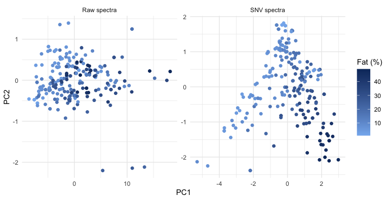
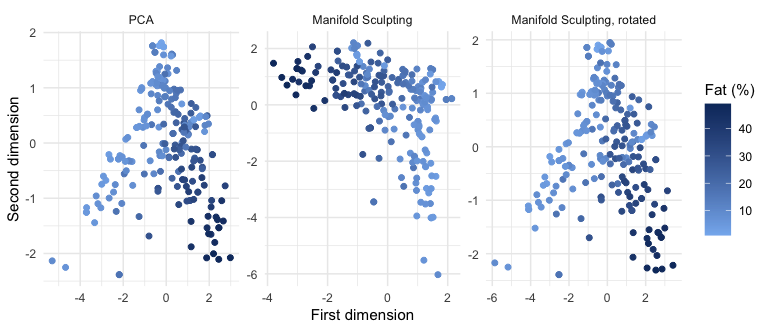
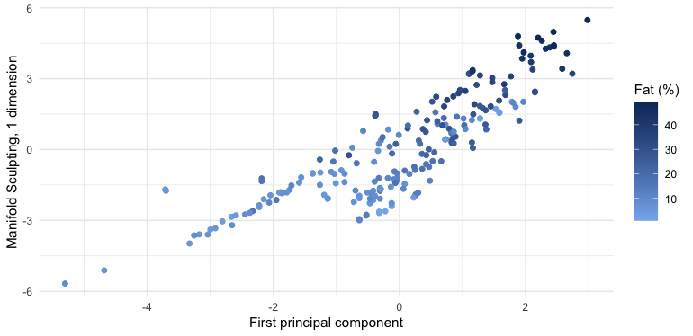
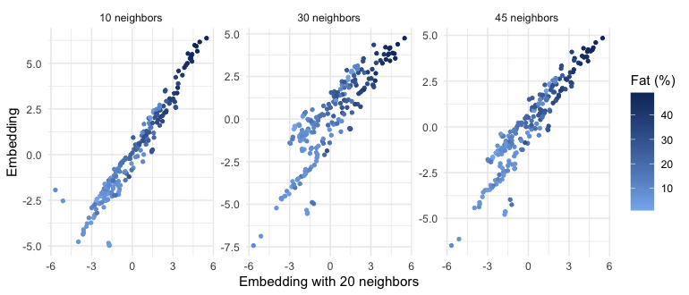
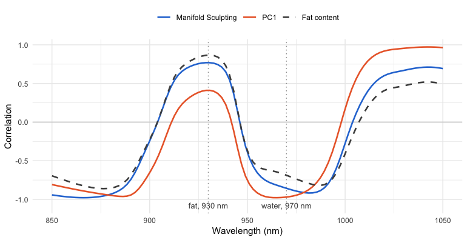
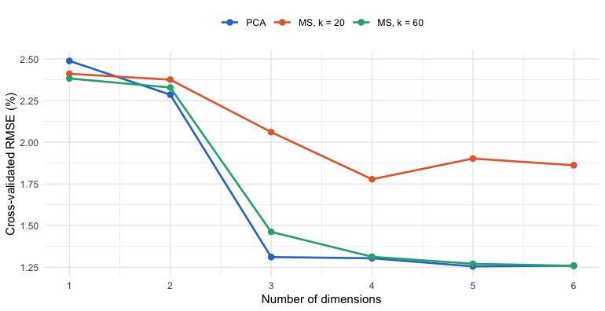

The principal component scores of near-infrared (NIR) spectra often lie on
an arch rather than in a cloud: the spectra respond nonlinearly to the
composition of the samples, and principal component analysis (PCA), which
is linear, bends the main gradient of composition over two components.
Manifold Sculpting is a tool to explore such structures. This vignette uses
it on the NIR spectra of meat to ask what the arch is, whether it is a
genuine curve of the spectra, and what coordinate runs along it, with the
tidyverse and tidymodels packages.

The results were computed once, with the code shown here, because some of
the computations take several minutes (see
[Reproducibility](#reproducibility)).


``` r
library(manifoldsculpting) # also attaches recipes
library(dplyr)
library(tidyr)
library(ggplot2)
library(rsample)
library(parsnip)
library(workflows)
library(tune)
library(yardstick)

theme_set(theme_minimal(base_size = 10))
blues <- c("#86b6ef", "#0d366b")
fat_colours <- scale_colour_gradient(low = blues[1], high = blues[2], name = "Fat (%)")
```

## The data

The `meats` data of the modeldata package are the Tecator data set
(Borggaard and Thodberg, 1992): 215 samples of finely chopped meat,
with their absorbance spectra measured by transmission at 100 wavelengths
from 850 to 1050 nm, and their water, fat and protein contents (%).


``` r
data(meats, package = "modeldata")
meats
#> # A tibble: 215 × 103
#>    x_001 x_002 x_003 x_004 x_005 x_006 x_007 x_008 x_009 x_010 x_011 x_012 x_013
#>    <dbl> <dbl> <dbl> <dbl> <dbl> <dbl> <dbl> <dbl> <dbl> <dbl> <dbl> <dbl> <dbl>
#>  1  2.62  2.62  2.62  2.62  2.62  2.62  2.62  2.62  2.63  2.63  2.63  2.63  2.64
#>  2  2.83  2.84  2.84  2.85  2.85  2.86  2.86  2.87  2.87  2.88  2.88  2.89  2.90
#>  3  2.58  2.58  2.59  2.59  2.59  2.59  2.59  2.60  2.60  2.60  2.60  2.61  2.61
#>  4  2.82  2.82  2.83  2.83  2.83  2.83  2.83  2.84  2.84  2.84  2.84  2.85  2.85
#>  5  2.79  2.79  2.79  2.79  2.80  2.80  2.80  2.80  2.81  2.81  2.81  2.82  2.82
#>  6  3.01  3.02  3.02  3.03  3.03  3.04  3.04  3.05  3.06  3.06  3.07  3.08  3.09
#>  7  2.99  2.99  3.00  3.01  3.01  3.02  3.02  3.03  3.04  3.04  3.05  3.06  3.07
#>  8  2.53  2.53  2.53  2.53  2.53  2.53  2.53  2.53  2.54  2.54  2.54  2.54  2.54
#>  9  3.27  3.28  3.29  3.29  3.30  3.31  3.31  3.32  3.33  3.33  3.34  3.35  3.36
#> 10  3.40  3.41  3.41  3.42  3.43  3.43  3.44  3.45  3.46  3.47  3.48  3.48  3.49
#> # ℹ 205 more rows
#> # ℹ 90 more variables: x_014 <dbl>, x_015 <dbl>, x_016 <dbl>, x_017 <dbl>,
#> #   x_018 <dbl>, x_019 <dbl>, x_020 <dbl>, x_021 <dbl>, x_022 <dbl>,
#> #   x_023 <dbl>, x_024 <dbl>, x_025 <dbl>, x_026 <dbl>, x_027 <dbl>,
#> #   x_028 <dbl>, x_029 <dbl>, x_030 <dbl>, x_031 <dbl>, x_032 <dbl>,
#> #   x_033 <dbl>, x_034 <dbl>, x_035 <dbl>, x_036 <dbl>, x_037 <dbl>,
#> #   x_038 <dbl>, x_039 <dbl>, x_040 <dbl>, x_041 <dbl>, x_042 <dbl>, …
```

In long format, with one row per sample and wavelength, the spectra are
easy to transform and to plot:


``` r
wavelengths <- seq(850, 1050, length.out = 100)

spectra <- meats |>
  mutate(sample = row_number()) |>
  pivot_longer(starts_with("x_"), names_to = "channel", values_to = "absorbance") |>
  mutate(wavelength = wavelengths[as.integer(sub("x_", "", channel))])

spectra
#> # A tibble: 21,500 × 7
#>    water   fat protein sample channel absorbance wavelength
#>    <dbl> <dbl>   <dbl>  <int> <chr>        <dbl>      <dbl>
#>  1  60.5  22.5    16.7      1 x_001         2.62       850 
#>  2  60.5  22.5    16.7      1 x_002         2.62       852.
#>  3  60.5  22.5    16.7      1 x_003         2.62       854.
#>  4  60.5  22.5    16.7      1 x_004         2.62       856.
#>  5  60.5  22.5    16.7      1 x_005         2.62       858.
#>  6  60.5  22.5    16.7      1 x_006         2.62       860.
#>  7  60.5  22.5    16.7      1 x_007         2.62       862.
#>  8  60.5  22.5    16.7      1 x_008         2.62       864.
#>  9  60.5  22.5    16.7      1 x_009         2.63       866.
#> 10  60.5  22.5    16.7      1 x_010         2.63       868.
#> # ℹ 21,490 more rows
```


``` r
ggplot(spectra, aes(wavelength, absorbance, group = sample, colour = fat)) +
  geom_line(linewidth = 0.3) +
  fat_colours +
  labs(x = "Wavelength (nm)", y = "Absorbance")
```


The spectra differ mostly by vertical offsets, caused by light scattering
in samples of different texture, which have little to do with their
composition. The composition itself has only two degrees of freedom,
since water, fat and protein add up to about 99%. Fat varies the most,
from 1% to 49%, and water
and protein decrease as it increases (correlations of
-0.99 and
-0.86).


``` r
ggplot(meats, aes(fat, protein)) +
  geom_point(size = 1.5, colour = blues[2], alpha = 0.7) +
  labs(x = "Fat (%)", y = "Protein (%)")
```


## Scatter correction

The standard normal variate (SNV) transformation (Barnes et al., 1989)
removes most of the scatter: each spectrum is centered and scaled by its
own mean and standard deviation.


``` r
spectra <- spectra |>
  group_by(sample) |>
  mutate(snv = (absorbance - mean(absorbance)) / sd(absorbance)) |>
  ungroup()

meats_snv <- spectra |>
  select(sample, water, fat, protein, channel, snv) |>
  pivot_wider(names_from = channel, values_from = snv) |>
  select(-sample)
```


``` r
ggplot(spectra, aes(wavelength, snv, group = sample, colour = fat)) +
  geom_line(linewidth = 0.3) +
  fat_colours +
  labs(x = "Wavelength (nm)", y = "SNV absorbance")
```


## The arch

The recipes share a first step: protein is the outcome, water and fat are
kept for the plots but are not predictors, and the spectra are centered.


``` r
base_recipe <- function(data) {
  recipe(protein ~ ., data = data) |>
    update_role(water, fat, new_role = "composition") |>
    step_center(all_predictors())
}

pca_raw <- base_recipe(meats) |>
  step_pca(all_predictors(), num_comp = 2) |>
  prep()
pca_snv <- base_recipe(meats_snv) |>
  step_pca(all_predictors(), num_comp = 2) |>
  prep()

# Percentage of variance of the first three components
variance <- bind_rows(
  raw = tidy(pca_raw, number = 2, type = "variance"),
  SNV = tidy(pca_snv, number = 2, type = "variance"),
  .id = "spectra"
) |>
  filter(terms == "percent variance", component <= 3) |>
  pivot_wider(names_from = component, names_prefix = "PC", values_from = value) |>
  select(spectra, PC1, PC2, PC3)
variance
#> # A tibble: 2 × 4
#>   spectra   PC1    PC2   PC3
#>   <chr>   <dbl>  <dbl> <dbl>
#> 1 raw      98.7  0.901 0.296
#> 2 SNV      68.1 29.1   1.63
```


``` r
pca_scores <- bind_rows(
  "Raw spectra" = bake(pca_raw, new_data = NULL),
  "SNV spectra" = bake(pca_snv, new_data = NULL),
  .id = "spectra"
)

ggplot(pca_scores, aes(PC1, PC2, colour = fat)) +
  geom_point(size = 1.5) +
  facet_wrap(~spectra, scales = "free") +
  fat_colours
```



On the raw spectra, the first component is the scatter, with
98.7% of the variance,
and the fat contents are mixed up. After the SNV transformation, the
first two components carry
68% and
29% of the variance, and
the scores lie on an **arch**. Fat runs along it, from the leanest
samples at the end of the left arm, over the top, to the fattest at the
end of the right arm. The fat content of a sample is given by its position
along the arch, and neither component follows it on its own: this is the
horseshoe effect of ordination methods (Diaconis et al., 2008), where one
dominant nonlinear gradient is bent over two components.

## Two dimensions keep the arch

`step_manifold_sculpting()` replaces `step_pca()` in the same recipe. It
looks for coordinates that preserve the distances and angles between
neighboring spectra (20 neighbors here), with the best of three runs:


``` r
ms_snv <- base_recipe(meats_snv) |>
  step_manifold_sculpting(all_predictors(), num_comp = 2, neighbors = 20,
                          options = list(nstart = 3), seed = 1) |>
  prep()

pca_snv_scores <- bake(pca_snv, new_data = NULL)
ms_scores <- bake(ms_snv, new_data = NULL)
ms_scores |> select(MS1, MS2, water, fat, protein)
#> # A tibble: 215 × 5
#>       MS1    MS2 water   fat protein
#>     <dbl>  <dbl> <dbl> <dbl>   <dbl>
#>  1  0.364  0.904  60.5  22.5    16.7
#>  2 -2.40   1.15   46    40.1    13.5
#>  3  0.959 -3.04   71     8.4    20.5
#>  4  1.44  -2.07   72.8   5.9    20.7
#>  5 -0.317  1.48   58.3  25.5    15.5
#>  6 -2.66   1.72   44    42.7    13.7
#>  7 -2.96   0.813  44    42.7    13.7
#>  8  1.02   0.650  69.3  10.6    19.3
#>  9 -0.705  1.13   61.4  19.9    17.7
#> 10 -0.764  0.490  61.4  19.9    17.7
#> # ℹ 205 more rows
```


``` r
# Rotate (and reflect) a configuration onto a target, by Procrustes analysis
procrustes <- function(x, target) {
  x <- scale(x, scale = FALSE)
  s <- svd(crossprod(x, scale(target, scale = FALSE)))
  x %*% s$u %*% t(s$v)
}
rotated <- procrustes(as.matrix(select(ms_scores, MS1, MS2)),
                      as.matrix(select(pca_snv_scores, PC1, PC2)))

method_levels <- c("PCA", "Manifold Sculpting", "Manifold Sculpting, rotated")
bind_rows(
  "PCA" = pca_snv_scores |> rename(dim_1 = PC1, dim_2 = PC2),
  "Manifold Sculpting" = ms_scores |> rename(dim_1 = MS1, dim_2 = MS2),
  "Manifold Sculpting, rotated" = ms_scores |> mutate(dim_1 = rotated[, 1], dim_2 = rotated[, 2]),
  .id = "method"
) |>
  mutate(method = factor(method, levels = method_levels)) |>
  ggplot(aes(dim_1, dim_2, colour = fat)) +
  geom_point(size = 1.5) +
  facet_wrap(~method, scales = "free") +
  fat_colours +
  labs(x = "First dimension", y = "Second dimension")
```



The embedding looks different from the PCA scores, but the orientation
and the scale of the axes of an embedding are arbitrary, and only its
shape matters. Rotated onto the PCA scores (right), it is the same arch:
each dimension of the embedding is almost exactly a linear combination of
the first two principal components.


``` r
# Share of each dimension of the embedding explained by PC1 and PC2
two_d <- bind_cols(ms_scores |> select(MS1, MS2), pca_snv_scores |> select(PC1, PC2))
two_d_r2 <- c(
  MS1 = summary(lm(MS1 ~ PC1 + PC2, data = two_d))$r.squared,
  MS2 = summary(lm(MS2 ~ PC1 + PC2, data = two_d))$r.squared
)
round(two_d_r2, 3)
#>   MS1   MS2 
#> 0.993 0.996
```

This is how Manifold Sculpting should behave. It preserves the geometry of
neighborhoods, and an arch that lies in a plane already has room to keep
it in two dimensions: straightening the arch would stretch its outer edge
and compress its inner one. The method unfolds a structure only when the
number of dimensions forces it to, as for the Swiss roll, a sheet rolled
up in three dimensions that is laid flat in two. The agreement with PCA is
thus a finding in itself: the arch is a genuine curve of the spectra,
lying in the plane of the first two components (which carry
97%
of the variance), and not the shadow of a structure folded in more
dimensions, which a projection would hide.

## One dimension unfolds it

The arch is a single gradient bent in two dimensions, and with one
dimension, Manifold Sculpting has to unfold it. The `manifold_sculpting()`
function computes the embedding directly from the matrix of SNV spectra:


``` r
snv <- as.matrix(select(meats_snv, starts_with("x_")))

# The sign of an embedding is arbitrary: orient it so that it increases with fat
along_fat <- function(x) x * sign(cor(x, meats_snv$fat))

set.seed(1)
ms_1d <- manifold_sculpting(snv, ndim = 1, neighbors = 20, nstart = 3)
ms_1d
#> Manifold Sculpting embedding
#> * 215 samples, 100 variables to 1 dimension
#> * 20 neighbors, squishing rate 0.99
#> * 549 iterations (converged), final error 1357
#> * Best of 3 runs, with final errors 1357, 1475, 1571

coordinates <- pca_snv_scores |>
  select(PC1, PC2, water, fat, protein) |>
  mutate(MS = along_fat(ms_1d$embedding[, 1]), PC1_fat = along_fat(PC1))
```


``` r
ggplot(coordinates, aes(PC1_fat, MS, colour = fat)) +
  geom_point(size = 1.5) +
  fat_colours +
  labs(x = "First principal component", y = "Manifold Sculpting, 1 dimension")
```



The two coordinates agree at the lean end of the arch, but not where it
turns. The first principal component projects the samples across the
arch, so that samples at its top and on its steep right arm can have the
same score. The embedding follows the arch, and places the leaner samples
of the top before the fatter samples of the arm, which sit above them in
the plot. It is therefore closer to the gradient of composition:


``` r
first_dimension <- coordinates |>
  pivot_longer(c(PC1_fat, MS), names_to = "method", values_to = "dimension") |>
  mutate(method = factor(method, levels = c("PC1_fat", "MS"),
                         labels = c("PC1", "Manifold Sculpting, 1 dimension"))) |>
  pivot_longer(c(water, fat, protein), names_to = "constituent", values_to = "percent") |>
  mutate(constituent = factor(constituent, levels = c("water", "fat", "protein")))

# Share of the variance of each constituent explained by a straight line
linearity <- first_dimension |>
  group_by(constituent, method) |>
  summarise(r_squared = cor(dimension, percent)^2, .groups = "drop") |>
  pivot_wider(names_from = method, values_from = r_squared)
linearity
#> # A tibble: 3 × 3
#>   constituent   PC1 `Manifold Sculpting, 1 dimension`
#>   <fct>       <dbl>                             <dbl>
#> 1 water       0.505                             0.739
#> 2 fat         0.453                             0.691
#> 3 protein     0.320                             0.371
```


``` r
ggplot(first_dimension, aes(dimension, percent)) +
  geom_point(size = 1, colour = blues[2], alpha = 0.6) +
  geom_smooth(method = "lm", formula = y ~ x, se = FALSE, colour = "#eb6834", linewidth = 0.6) +
  facet_grid(constituent ~ method, scales = "free") +
  labs(x = NULL, y = "Content (%)")
```


A straight line on the one-dimensional embedding explains
74% of the
variance of water and
69% of fat,
against 51%
and 45% for
the first principal component, whose relation with the contents bends at
the ends of the arch. Protein gains less
(37%
against 32%):
it decreases as fat increases, but it is not a function of the fat and
water gradient alone. No reference value was used to obtain this
coordinate.

## How stable is the coordinate?

An exploratory embedding is only useful if its features do not depend on
the settings. The coordinate is computed again with 10 to 45 neighbors:


``` r
k_values <- c(10, 20, 30, 45)
stability <- lapply(k_values, function(k) {
  set.seed(1)
  fit <- manifold_sculpting(snv, ndim = 1, neighbors = k, nstart = 3)
  tibble(neighbors = k, sample = seq_len(nrow(snv)),
         MS = along_fat(fit$embedding[, 1]))
}) |>
  bind_rows() |>
  left_join(coordinates |> mutate(sample = row_number()), by = "sample",
            suffix = c("", "_20"))

stability_summary <- stability |>
  group_by(neighbors) |>
  summarise(
    rank_cor_k20 = cor(MS, MS_20, method = "spearman"),
    r2_water = cor(MS, water)^2,
    r2_fat = cor(MS, fat)^2,
    r2_protein = cor(MS, protein)^2
  )
stability_summary
#> # A tibble: 4 × 5
#>   neighbors rank_cor_k20 r2_water r2_fat r2_protein
#>       <dbl>        <dbl>    <dbl>  <dbl>      <dbl>
#> 1        10        0.969    0.738  0.686      0.400
#> 2        20        1        0.739  0.691      0.371
#> 3        30        0.875    0.525  0.469      0.322
#> 4        45        0.935    0.643  0.587      0.372
```


``` r
stability |>
  filter(neighbors != 20) |>
  mutate(neighbors = factor(neighbors, levels = k_values, labels = paste(k_values, "neighbors"))) |>
  ggplot(aes(MS_20, MS, colour = fat)) +
  geom_point(size = 1) +
  facet_wrap(~neighbors, scales = "free_y") +
  fat_colours +
  labs(x = "Embedding with 20 neighbors", y = "Embedding")
```



The order of the samples is stable: whatever the number of neighbors,
the coordinate ranks them nearly as with 20 neighbors (a rank correlation
of at least 0.88). How
evenly it spreads them varies more, as the bends in the plots show, and
with it the share of the variance of water that a straight line explains,
from
52% to
74% (against
51% for the
first principal component). Trying a few numbers of neighbors, as here,
tells which features of an embedding can be trusted.

## What drives the coordinate

Manifold Sculpting has no loadings, but the correlation between the SNV
absorbance at each wavelength and the coordinate shows which parts of the
spectra it follows. The same correlations with the first principal
component and with the fat content are shown for comparison:


``` r
profiles <- tibble(
  wavelength = wavelengths,
  "Manifold Sculpting" = cor(snv, coordinates$MS)[, 1],
  "PC1" = cor(snv, coordinates$PC1_fat)[, 1],
  "Fat content" = cor(snv, meats_snv$fat)[, 1]
)

# How closely the profile of each coordinate follows that of fat
profile_fit <- c(
  "Manifold Sculpting" = cor(profiles[["Manifold Sculpting"]], profiles[["Fat content"]]),
  "PC1" = cor(profiles$PC1, profiles[["Fat content"]])
)
round(profile_fit, 3)
#> Manifold Sculpting                PC1 
#>              0.986              0.850
peak <- profiles$wavelength[which.max(profiles[["Manifold Sculpting"]])]
```


``` r
profiles_long <- profiles |>
  pivot_longer(-wavelength, names_to = "variable", values_to = "r") |>
  mutate(variable = factor(variable, levels = c("Manifold Sculpting", "PC1", "Fat content")))

ggplot(profiles_long, aes(wavelength, r, colour = variable, linetype = variable)) +
  geom_hline(yintercept = 0, colour = "grey80") +
  geom_vline(xintercept = c(930, 970), colour = "grey60", linetype = "dotted") +
  annotate("text", x = c(930, 970), y = -1.08, label = c("fat, 930 nm", "water, 970 nm"),
           size = 3, colour = "grey30") +
  geom_line(linewidth = 0.8) +
  scale_colour_manual(values = c("#2a78d6", "#eb6834", "grey30")) +
  scale_linetype_manual(values = c("solid", "solid", "dashed")) +
  labs(x = "Wavelength (nm)", y = "Correlation", colour = NULL, linetype = NULL) +
  theme(legend.position = "top")
```



The profile of the coordinate is almost that of the fat content (a
correlation of 0.99
between the two profiles, against
0.85 for the first principal
component), with its maximum at 929 nm, at the absorption band
of fat near 930 nm (third overtone of the C–H stretching vibration). The
coordinate is the gradient of fat against water, while the first principal
component mixes it with the bending of the arch.

## What unfolding does not do

The coordinate follows the main gradient of composition, without any
reference value. Does unfolding also help to predict a minor constituent
such as protein? Principal component regression and its Manifold Sculpting
analog, a linear regression on 1 to 6 dimensions, are compared by 10-fold
cross-validation, with 20 neighbors as above and with 60:


``` r
set.seed(2026)
folds <- vfold_cv(meats_snv, v = 10, strata = protein)

pca_wflow <- workflow(
  base_recipe(meats_snv) |>
    step_pca(all_predictors(), num_comp = tune()),
  linear_reg()
)
ms_wflow <- workflow(
  base_recipe(meats_snv) |>
    step_manifold_sculpting(all_predictors(), num_comp = tune(), neighbors = tune(),
                            options = list(nstart = 3), seed = 1),
  linear_reg()
)

pca_cv <- tune_grid(pca_wflow, resamples = folds, grid = tibble(num_comp = 1:6),
                    metrics = metric_set(rmse))
ms_cv <- tune_grid(ms_wflow, resamples = folds,
                   grid = crossing(num_comp = 1:6, neighbors = c(20, 60)),
                   metrics = metric_set(rmse))

cv_results <- bind_rows(
  collect_metrics(pca_cv) |> mutate(model = "PCA"),
  collect_metrics(ms_cv) |> mutate(model = paste0("MS, k = ", neighbors))
) |>
  mutate(model = factor(model, levels = c("PCA", "MS, k = 20", "MS, k = 60")))
cv_results |>
  group_by(model) |>
  slice_min(mean, n = 1) |>
  select(model, num_comp, rmse = mean, std_err)
#> # A tibble: 3 × 4
#> # Groups:   model [3]
#>   model      num_comp  rmse std_err
#>   <fct>         <int> <dbl>   <dbl>
#> 1 PCA               5  1.26  0.0793
#> 2 MS, k = 20        4  1.78  0.122 
#> 3 MS, k = 60        6  1.26  0.0752
```


``` r
ggplot(cv_results, aes(num_comp, mean, colour = model)) +
  geom_line(linewidth = 0.8) +
  geom_point(size = 2) +
  scale_colour_manual(values = c("#2a78d6", "#eb6834", "#1baf7a")) +
  scale_x_continuous(breaks = 1:6) +
  labs(x = "Number of dimensions", y = "Cross-validated RMSE (%)", colour = NULL) +
  theme(legend.position = "top")
```




With the 20 neighbors that unfold the arch, the regression on the
embedding is clearly worse than principal component regression (a
cross-validated RMSE of 1.78 at best,
against 1.26). With 60 neighbors, it is as
accurate (1.26). Protein absorbs weakly
between 850 and 1050 nm, where the bands of water and fat dominate, and
much of its signal is in directions of small variance: the third principal
component, with 1.6% of
the variance, reduces the RMSE of principal component regression from
2.29 to
1.31. Manifold
Sculpting, which preserves the geometry of neighborhoods, keeps such small
variations only with large neighborhoods, where it behaves like a global
method. For the calibration of a minor constituent, a linear model on
enough components, such as principal component regression or partial
least squares, is as accurate and simpler.

## What we see

- **The arch is the gradient of fat.** Once the scatter is removed, the
  PCA scores lie on an arch, along which fat increases from one end to
  the other: one nonlinear gradient bent over two components.
- **Two dimensions keep the arch.** The two-dimensional embedding has the
  shape of the PCA scores: the arch is a genuine curve of the spectra,
  lying in a plane, which Manifold Sculpting has no reason to straighten.
- **One dimension unfolds it.** The one-dimensional embedding orders the
  samples along the arch, and its profile over the wavelengths is that of
  fat. With 20 neighbors, it follows water and fat much more closely than
  the first principal component; its order is stable across numbers of
  neighbors, but how much closer it is varies.
- **Unfolding is not calibration.** The embedding does not predict protein
  better than the principal components, and matches them only with large
  neighborhoods.

Manifold Sculpting is thus an exploratory tool for spectra: it tells
whether a curved structure in a score plot is genuine, and gives a
coordinate along it without reference values. The same approach applies
whenever spectra follow one curved path, as in the monitoring of a
process, a reaction or the ripening of a product over time, where such a
coordinate can track progress before any reference analysis is available.

## Reproducibility

The vignette was computed with the following versions:


|Package           |Version |
|:-----------------|:-------|
|manifoldsculpting |1.2.1   |
|modeldata         |1.6.0   |
|recipes           |1.4.0   |
|rsample           |1.3.2   |
|parsnip           |1.6.1   |
|workflows         |1.3.0   |
|tune              |2.1.0   |
|yardstick         |1.4.0   |
|dplyr             |1.2.1   |
|tidyr             |1.3.2   |
|ggplot2           |4.0.3   |


To compute it again, install these packages and run
`vignettes/precompute.R` from the source of the package. It knits
`vignettes/spectroscopy.Rmd.orig`, which holds the code, into
`vignettes/spectroscopy.Rmd`.

## References

Barnes, R. J., Dhanoa, M. S. and Lister, S. J. (1989). Standard normal
variate transformation and de-trending of near-infrared diffuse
reflectance spectra. *Applied Spectroscopy*, 43, 772–777.

Borggaard, C. and Thodberg, H. H. (1992). Optimal minimal neural
interpretation of spectra. *Analytical Chemistry*, 64, 545–551.

Diaconis, P., Goel, S. and Holmes, S. (2008). Horseshoes in
multidimensional scaling and local kernel methods. *The Annals of
Applied Statistics*, 2, 777–807.

Gashler, M., Ventura, D. and Martinez, T. (2008). Iterative non-linear
dimensionality reduction with manifold sculpting. In *Advances in Neural
Information Processing Systems 20*, 513–520.
