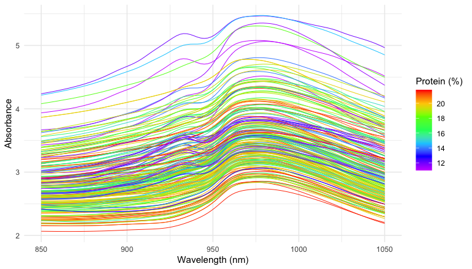
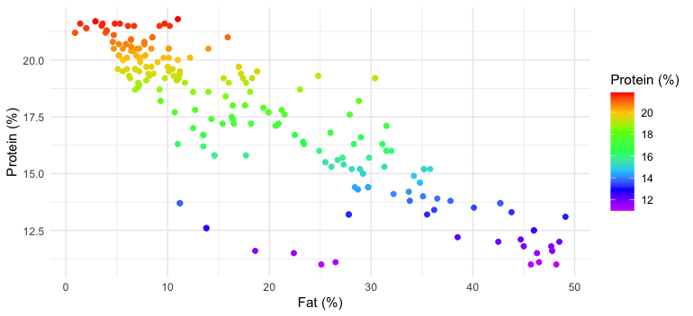
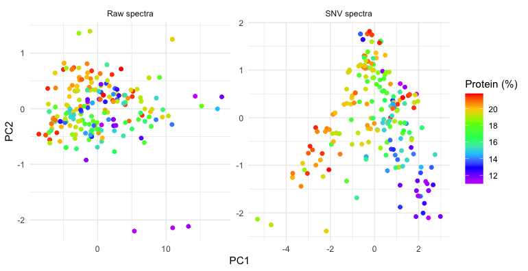
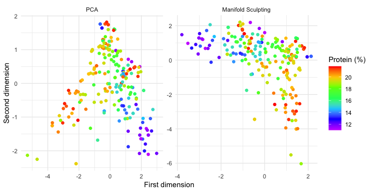
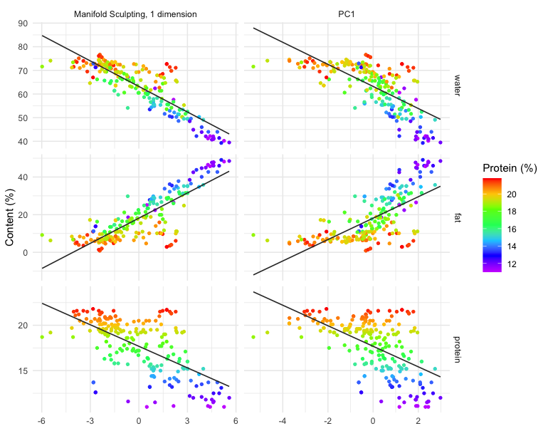
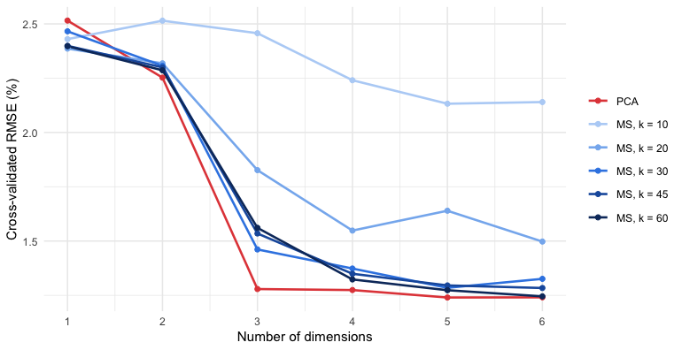
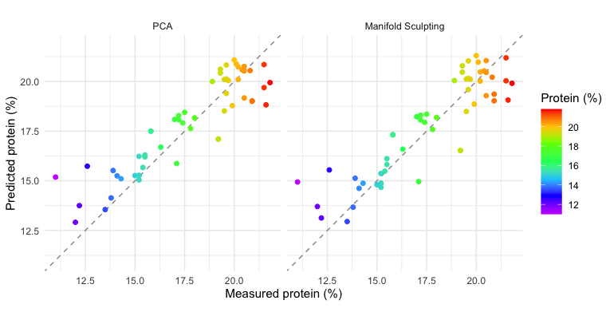

The principal component scores of near-infrared (NIR) spectra often lie on
a curve rather than in a cloud: the spectra respond nonlinearly to the
composition of the samples, and principal component analysis (PCA), which
is linear, bends the main gradient of the data into an arch. This vignette
looks at such an arch in the NIR spectra of meat, unfolds it with Manifold
Sculpting, and asks whether the unfolded coordinates predict the protein
content of the samples better than the principal components, with the
tidyverse and tidymodels packages.

The results were computed once, with the code shown here, because tuning
the models takes several minutes (see [Reproducibility](#reproducibility)).


``` r
library(manifoldsculpting) # also attaches recipes
library(dplyr)
library(tidyr)
library(ggplot2)
library(rsample)
library(parsnip)
library(workflows)
library(tune)
library(yardstick)

theme_set(theme_minimal(base_size = 10))
rainbow_protein <- scale_colour_gradientn(
  colours = rev(rainbow(7, end = 0.8)),
  name = "Protein (%)"
)
```

## The data

The `meats` data of the modeldata package are the Tecator data set
(Borggaard and Thodberg, 1992): 215 samples of finely chopped meat,
with their absorbance spectra measured by transmission at 100 wavelengths
from 850 to 1050 nm, and their water, fat and protein contents (%).


``` r
data(meats, package = "modeldata")
meats
#> # A tibble: 215 × 103
#>    x_001 x_002 x_003 x_004 x_005 x_006 x_007 x_008 x_009 x_010 x_011 x_012 x_013
#>    <dbl> <dbl> <dbl> <dbl> <dbl> <dbl> <dbl> <dbl> <dbl> <dbl> <dbl> <dbl> <dbl>
#>  1  2.62  2.62  2.62  2.62  2.62  2.62  2.62  2.62  2.63  2.63  2.63  2.63  2.64
#>  2  2.83  2.84  2.84  2.85  2.85  2.86  2.86  2.87  2.87  2.88  2.88  2.89  2.90
#>  3  2.58  2.58  2.59  2.59  2.59  2.59  2.59  2.60  2.60  2.60  2.60  2.61  2.61
#>  4  2.82  2.82  2.83  2.83  2.83  2.83  2.83  2.84  2.84  2.84  2.84  2.85  2.85
#>  5  2.79  2.79  2.79  2.79  2.80  2.80  2.80  2.80  2.81  2.81  2.81  2.82  2.82
#>  6  3.01  3.02  3.02  3.03  3.03  3.04  3.04  3.05  3.06  3.06  3.07  3.08  3.09
#>  7  2.99  2.99  3.00  3.01  3.01  3.02  3.02  3.03  3.04  3.04  3.05  3.06  3.07
#>  8  2.53  2.53  2.53  2.53  2.53  2.53  2.53  2.53  2.54  2.54  2.54  2.54  2.54
#>  9  3.27  3.28  3.29  3.29  3.30  3.31  3.31  3.32  3.33  3.33  3.34  3.35  3.36
#> 10  3.40  3.41  3.41  3.42  3.43  3.43  3.44  3.45  3.46  3.47  3.48  3.48  3.49
#> # ℹ 205 more rows
#> # ℹ 90 more variables: x_014 <dbl>, x_015 <dbl>, x_016 <dbl>, x_017 <dbl>,
#> #   x_018 <dbl>, x_019 <dbl>, x_020 <dbl>, x_021 <dbl>, x_022 <dbl>,
#> #   x_023 <dbl>, x_024 <dbl>, x_025 <dbl>, x_026 <dbl>, x_027 <dbl>,
#> #   x_028 <dbl>, x_029 <dbl>, x_030 <dbl>, x_031 <dbl>, x_032 <dbl>,
#> #   x_033 <dbl>, x_034 <dbl>, x_035 <dbl>, x_036 <dbl>, x_037 <dbl>,
#> #   x_038 <dbl>, x_039 <dbl>, x_040 <dbl>, x_041 <dbl>, x_042 <dbl>, …
```

In long format, with one row per sample and wavelength, the spectra are
easy to transform and to plot:


``` r
wavelengths <- seq(850, 1050, length.out = 100)

spectra <- meats |>
  mutate(sample = row_number()) |>
  pivot_longer(starts_with("x_"), names_to = "channel", values_to = "absorbance") |>
  mutate(wavelength = wavelengths[as.integer(sub("x_", "", channel))])

spectra
#> # A tibble: 21,500 × 7
#>    water   fat protein sample channel absorbance wavelength
#>    <dbl> <dbl>   <dbl>  <int> <chr>        <dbl>      <dbl>
#>  1  60.5  22.5    16.7      1 x_001         2.62       850 
#>  2  60.5  22.5    16.7      1 x_002         2.62       852.
#>  3  60.5  22.5    16.7      1 x_003         2.62       854.
#>  4  60.5  22.5    16.7      1 x_004         2.62       856.
#>  5  60.5  22.5    16.7      1 x_005         2.62       858.
#>  6  60.5  22.5    16.7      1 x_006         2.62       860.
#>  7  60.5  22.5    16.7      1 x_007         2.62       862.
#>  8  60.5  22.5    16.7      1 x_008         2.62       864.
#>  9  60.5  22.5    16.7      1 x_009         2.63       866.
#> 10  60.5  22.5    16.7      1 x_010         2.63       868.
#> # ℹ 21,490 more rows
```


``` r
ggplot(spectra, aes(wavelength, absorbance, group = sample, colour = protein)) +
  geom_line(linewidth = 0.3) +
  rainbow_protein +
  labs(x = "Wavelength (nm)", y = "Absorbance")
```



The spectra differ mostly by vertical offsets, caused by light scattering
in samples of different texture, which have little to do with their
composition. The composition itself has only two degrees of freedom,
since water, fat and protein add up to about 99%: protein decreases as fat
increases (correlation -0.86), but
among lean samples it varies on its own.


``` r
ggplot(meats, aes(fat, protein, colour = protein)) +
  geom_point(size = 1.5) +
  rainbow_protein +
  labs(x = "Fat (%)", y = "Protein (%)")
```



## Scatter correction

The standard normal variate (SNV) transformation (Barnes et al., 1989)
removes most of the scatter: each spectrum is centered and scaled by its
own mean and standard deviation.


``` r
spectra <- spectra |>
  group_by(sample) |>
  mutate(snv = (absorbance - mean(absorbance)) / sd(absorbance)) |>
  ungroup()

meats_snv <- spectra |>
  select(sample, water, fat, protein, channel, snv) |>
  pivot_wider(names_from = channel, values_from = snv) |>
  select(-sample)
```


``` r
ggplot(spectra, aes(wavelength, snv, group = sample, colour = protein)) +
  geom_line(linewidth = 0.3) +
  rainbow_protein +
  labs(x = "Wavelength (nm)", y = "SNV absorbance")
```


## Principal component analysis

The models share a recipe: protein is the outcome, water and fat are kept
for the plots but are not predictors, and the spectra are centered.


``` r
base_recipe <- function(data) {
  recipe(protein ~ ., data = data) |>
    update_role(water, fat, new_role = "composition") |>
    step_center(all_predictors())
}

pca_raw <- base_recipe(meats) |>
  step_pca(all_predictors(), num_comp = 2) |>
  prep()
pca_snv <- base_recipe(meats_snv) |>
  step_pca(all_predictors(), num_comp = 2) |>
  prep()

# Percentage of variance of the first three components
variance <- bind_rows(
  raw = tidy(pca_raw, number = 2, type = "variance"),
  SNV = tidy(pca_snv, number = 2, type = "variance"),
  .id = "spectra"
) |>
  filter(terms == "percent variance", component <= 3) |>
  pivot_wider(names_from = component, names_prefix = "PC", values_from = value) |>
  select(spectra, PC1, PC2, PC3)
variance
#> # A tibble: 2 × 4
#>   spectra   PC1    PC2   PC3
#>   <chr>   <dbl>  <dbl> <dbl>
#> 1 raw      98.7  0.901 0.296
#> 2 SNV      68.1 29.1   1.63
```


``` r
pca_scores <- bind_rows(
  "Raw spectra" = bake(pca_raw, new_data = NULL),
  "SNV spectra" = bake(pca_snv, new_data = NULL),
  .id = "spectra"
)

ggplot(pca_scores, aes(PC1, PC2, colour = protein)) +
  geom_point(size = 1.5) +
  facet_wrap(~spectra, scales = "free") +
  rainbow_protein
```



On the raw spectra, the first component is the scatter, with
98.7% of the variance,
and the protein contents are mixed up. After the SNV transformation, the
first two components carry
68% and
29% of the variance, and
the scores lie on an **arch**: the samples richest in protein are along
the left arm and at the top, and the poorest at the end of the right arm. This is the horseshoe effect of ordination methods
(Diaconis et al., 2008): when the data follow one dominant nonlinear
gradient, PCA represents it by a curve that spreads over two components.
Here, the gradient is mostly that of fat and water, which change the
spectra the most, and protein follows it because it decreases as fat
increases.

## Manifold Sculpting

`step_manifold_sculpting()` replaces `step_pca()` in the same recipe. It
looks for coordinates that preserve the distances and angles between
neighboring spectra (20 neighbors here), with the best of three runs:


``` r
ms_snv <- base_recipe(meats_snv) |>
  step_manifold_sculpting(all_predictors(), num_comp = 2, neighbors = 20,
                          options = list(nstart = 3), seed = 1) |>
  prep()

ms_scores <- bake(ms_snv, new_data = NULL)
ms_scores |> select(MS1, MS2, water, fat, protein)
#> # A tibble: 215 × 5
#>       MS1    MS2 water   fat protein
#>     <dbl>  <dbl> <dbl> <dbl>   <dbl>
#>  1  0.364  0.904  60.5  22.5    16.7
#>  2 -2.40   1.15   46    40.1    13.5
#>  3  0.959 -3.04   71     8.4    20.5
#>  4  1.44  -2.07   72.8   5.9    20.7
#>  5 -0.317  1.48   58.3  25.5    15.5
#>  6 -2.66   1.72   44    42.7    13.7
#>  7 -2.96   0.813  44    42.7    13.7
#>  8  1.02   0.650  69.3  10.6    19.3
#>  9 -0.705  1.13   61.4  19.9    17.7
#> 10 -0.764  0.490  61.4  19.9    17.7
#> # ℹ 205 more rows
```


``` r
bind_rows(
  "PCA" = bake(pca_snv, new_data = NULL) |> rename(dim_1 = PC1, dim_2 = PC2),
  "Manifold Sculpting" = ms_scores |> rename(dim_1 = MS1, dim_2 = MS2),
  .id = "method"
) |>
  mutate(method = factor(method, levels = c("PCA", "Manifold Sculpting"))) |>
  ggplot(aes(dim_1, dim_2, colour = protein)) +
  geom_point(size = 1.5) +
  facet_wrap(~method, scales = "free") +
  rainbow_protein +
  labs(x = "First dimension", y = "Second dimension")
```



Manifold Sculpting unfolds the arch. The main gradient now runs along the
first dimension, from the fattest samples, poorest in protein, on one side
to the leanest on the other. The samples of the left arm of the arch, lean
and rich in protein, form a separate branch along the second dimension:


``` r
# Where the samples of the left arm of the PCA arch are in the embedding
ms_scores |>
  mutate(PC1 = bake(pca_snv, new_data = NULL)$PC1) |>
  mutate(arch = if_else(PC1 < -1.5, "left arm", "rest of the arch")) |>
  group_by(arch) |>
  summarise(samples = n(), across(c(MS1, MS2, water, fat, protein), mean))
#> # A tibble: 2 × 7
#>   arch             samples    MS1    MS2 water   fat protein
#>   <chr>              <int>  <dbl>  <dbl> <dbl> <dbl>   <dbl>
#> 1 left arm              34  1.04  -2.89   71.4   8.1    20.2
#> 2 rest of the arch     181 -0.196  0.543  61.7  20.0    17.2
```

The two branches are the two degrees of freedom of the composition: the
gradient of fat against water and protein, and, among lean samples, the
variation of protein on its own. PCA folds them into one arch; Manifold
Sculpting lays them side by side.

The first dimension alone shows the difference with PCA. With a single
dimension, Manifold Sculpting orders the spectra along the arch, while the
first principal component is a projection across it:


``` r
first_dimension <- bind_rows(
  "PC1" = base_recipe(meats_snv) |>
    step_pca(all_predictors(), num_comp = 1) |>
    prep() |>
    bake(new_data = NULL) |>
    rename(dimension = PC1),
  "Manifold Sculpting, 1 dimension" = base_recipe(meats_snv) |>
    step_manifold_sculpting(all_predictors(), num_comp = 1, neighbors = 20,
                            options = list(nstart = 3), seed = 1) |>
    prep() |>
    bake(new_data = NULL) |>
    rename(dimension = MS1),
  .id = "method"
) |>
  mutate(protein_level = protein) |>
  pivot_longer(c(water, fat, protein), names_to = "constituent", values_to = "percent") |>
  mutate(constituent = factor(constituent, levels = c("water", "fat", "protein")))

# Share of the variance of each constituent explained by a straight line
linearity <- first_dimension |>
  group_by(constituent, method) |>
  summarise(r_squared = cor(dimension, percent)^2, .groups = "drop") |>
  pivot_wider(names_from = method, values_from = r_squared)
linearity
#> # A tibble: 3 × 3
#>   constituent `Manifold Sculpting, 1 dimension`   PC1
#>   <fct>                                   <dbl> <dbl>
#> 1 water                                   0.734 0.505
#> 2 fat                                     0.682 0.453
#> 3 protein                                 0.383 0.320
```


``` r
ggplot(first_dimension, aes(dimension, percent, colour = protein_level)) +
  geom_point(size = 1) +
  geom_smooth(method = "lm", formula = y ~ x, se = FALSE, colour = "grey20", linewidth = 0.5) +
  facet_grid(constituent ~ method, scales = "free") +
  rainbow_protein +
  labs(x = NULL, y = "Content (%)")
```



A straight line on the one-dimensional embedding explains
73% of the
variance of water and
68% of fat,
against 51%
and 45% for
the first principal component, whose relation with the contents bends at
the ends of the arch. Protein gains less
(38%
against 32%):
as the composition plot showed, it is not a function of the fat and water
gradient alone.

## Predicting protein

Does unfolding the arch help to predict protein? Principal component
regression and its Manifold Sculpting analog are compared, a linear
regression on 1 to 6 dimensions. The samples are split into a training
set (75%) and a test set, and the number of dimensions (and, for Manifold
Sculpting, the number of neighbors) is chosen by 10-fold cross-validation
on the training set.


``` r
set.seed(2026)
meats_split <- initial_split(meats_snv, prop = 0.75, strata = protein)
meats_train <- training(meats_split)
folds <- vfold_cv(meats_train, v = 10, strata = protein)

pca_wflow <- workflow(
  base_recipe(meats_train) |>
    step_pca(all_predictors(), num_comp = tune()),
  linear_reg()
)
ms_wflow <- workflow(
  base_recipe(meats_train) |>
    step_manifold_sculpting(all_predictors(), num_comp = tune(), neighbors = tune(),
                            options = list(nstart = 3), seed = 1),
  linear_reg()
)
```


``` r
pca_tuned <- tune_grid(
  pca_wflow,
  resamples = folds,
  grid = tibble(num_comp = 1:6),
  metrics = metric_set(rmse, rsq)
)
ms_tuned <- tune_grid(
  ms_wflow,
  resamples = folds,
  grid = crossing(num_comp = 1:6, neighbors = c(10, 20, 30, 45, 60)),
  metrics = metric_set(rmse, rsq)
)
```


``` r
cv_results <- bind_rows(
  collect_metrics(pca_tuned) |> mutate(model = "PCA"),
  collect_metrics(ms_tuned) |> mutate(model = paste0("MS, k = ", neighbors))
) |>
  filter(.metric == "rmse")
model_levels <- c("PCA", paste0("MS, k = ", c(10, 20, 30, 45, 60)))

ggplot(cv_results, aes(num_comp, mean, colour = factor(model, levels = model_levels))) +
  geom_line(linewidth = 0.8) +
  geom_point(size = 1.5) +
  scale_colour_manual(values = c("#e34948", "#b7d3f6", "#86b6ef", "#3987e5", "#1c5cab", "#0d366b")) +
  scale_x_continuous(breaks = 1:6) +
  labs(x = "Number of dimensions", y = "Cross-validated RMSE (%)", colour = NULL)
```




``` r
best_pca <- show_best(pca_tuned, metric = "rmse", n = 3)
best_ms <- show_best(ms_tuned, metric = "rmse", n = 3)
pca_rmse <- collect_metrics(pca_tuned) |> filter(.metric == "rmse")
best_pca
#> # A tibble: 3 × 7
#>   num_comp .metric .estimator  mean     n std_err .config        
#>      <int> <chr>   <chr>      <dbl> <int>   <dbl> <chr>          
#> 1        5 rmse    standard    1.24    10   0.119 pre5_mod0_post0
#> 2        6 rmse    standard    1.24    10   0.116 pre6_mod0_post0
#> 3        4 rmse    standard    1.27    10   0.131 pre4_mod0_post0
best_ms
#> # A tibble: 3 × 8
#>   num_comp neighbors .metric .estimator  mean     n std_err .config         
#>      <int>     <dbl> <chr>   <chr>      <dbl> <int>   <dbl> <chr>           
#> 1        6        60 rmse    standard    1.25    10   0.126 pre30_mod0_post0
#> 2        5        60 rmse    standard    1.27    10   0.101 pre25_mod0_post0
#> 3        6        45 rmse    standard    1.28    10   0.104 pre29_mod0_post0
```

The best settings of each model are refitted on the whole training set
and evaluated on the test set:


``` r
pca_final <- pca_wflow |>
  finalize_workflow(select_best(pca_tuned, metric = "rmse")) |>
  last_fit(meats_split, metrics = metric_set(rmse, rsq))
ms_final <- ms_wflow |>
  finalize_workflow(select_best(ms_tuned, metric = "rmse")) |>
  last_fit(meats_split, metrics = metric_set(rmse, rsq))

test_metrics <- bind_rows(
  "PCA" = collect_metrics(pca_final),
  "Manifold Sculpting" = collect_metrics(ms_final),
  .id = "model"
) |>
  select(model, .metric, .estimate) |>
  pivot_wider(names_from = .metric, values_from = .estimate)
test_metrics
#> # A tibble: 2 × 3
#>   model               rmse   rsq
#>   <chr>              <dbl> <dbl>
#> 1 PCA                 1.30 0.810
#> 2 Manifold Sculpting  1.30 0.796
```


``` r
bind_rows(
  "PCA" = collect_predictions(pca_final),
  "Manifold Sculpting" = collect_predictions(ms_final),
  .id = "model"
) |>
  mutate(model = factor(model, levels = c("PCA", "Manifold Sculpting"))) |>
  ggplot(aes(protein, .pred, colour = protein)) +
  geom_abline(colour = "grey60", linetype = "dashed") +
  geom_point(size = 1.5) +
  facet_wrap(~model) +
  coord_obs_pred() +
  rainbow_protein +
  labs(x = "Measured protein (%)", y = "Predicted protein (%)")
```



With few neighbors, the regression on the Manifold Sculpting embedding is
clearly worse than principal component regression. It improves with the
number of neighbors and, with 60 neighbors and
6 dimensions, matches principal component regression
with 5 components (cross-validated RMSE of
1.25 and 1.24). On the
test set, the two models are equally accurate (RMSE of
1.30
and 1.30).

## What we see

- **The arch is real.** Once the scatter is removed, the PCA scores of
  the spectra lie on an arch: one nonlinear structure spread over two
  components, the horseshoe effect.
- **Manifold Sculpting unfolds it.** Its embedding separates the two
  degrees of freedom of the composition, the fat and water gradient and
  the protein content of lean samples, which the arch folds together.
  With one dimension, it gives a coordinate along the fat and water
  gradient that is much closer to linear than the first principal
  component.
- **Unfolding does not improve the prediction of protein.** Protein
  absorbs weakly between 850 and 1050 nm, where the bands of water and fat
  dominate, and much of its signal is in components of small variance:
  the third principal component, with
  1.6% of the variance,
  reduces the cross-validated RMSE of principal component regression from
  2.25 to
  1.28. Manifold Sculpting,
  which preserves the geometry of neighborhoods, keeps such small
  variations only with large neighborhoods, where it behaves more like a
  global method, and the two regressions are then equally accurate.

Manifold Sculpting is thus a tool to see the structure of the spectra,
and to obtain coordinates that follow the main gradient of composition.
For the calibration of a minor constituent such as protein, a linear
model on enough components, such as principal component regression or
partial least squares, remains as accurate and simpler.

## Reproducibility

The vignette was computed with the following versions:


|Package           |Version |
|:-----------------|:-------|
|manifoldsculpting |1.2.1   |
|modeldata         |1.6.0   |
|recipes           |1.4.0   |
|rsample           |1.3.2   |
|parsnip           |1.6.1   |
|workflows         |1.3.0   |
|tune              |2.1.0   |
|yardstick         |1.4.0   |
|dplyr             |1.2.1   |
|tidyr             |1.3.2   |
|ggplot2           |4.0.3   |


To compute it again, install these packages and run
`vignettes/precompute.R` from the source of the package. It knits
`vignettes/spectroscopy.Rmd.orig`, which holds the code, into
`vignettes/spectroscopy.Rmd`.

## References

Barnes, R. J., Dhanoa, M. S. and Lister, S. J. (1989). Standard normal
variate transformation and de-trending of near-infrared diffuse
reflectance spectra. *Applied Spectroscopy*, 43, 772–777.

Borggaard, C. and Thodberg, H. H. (1992). Optimal minimal neural
interpretation of spectra. *Analytical Chemistry*, 64, 545–551.

Diaconis, P., Goel, S. and Holmes, S. (2008). Horseshoes in
multidimensional scaling and local kernel methods. *The Annals of
Applied Statistics*, 2, 777–807.

Gashler, M., Ventura, D. and Martinez, T. (2008). Iterative non-linear
dimensionality reduction with manifold sculpting. In *Advances in Neural
Information Processing Systems 20*, 513–520.
